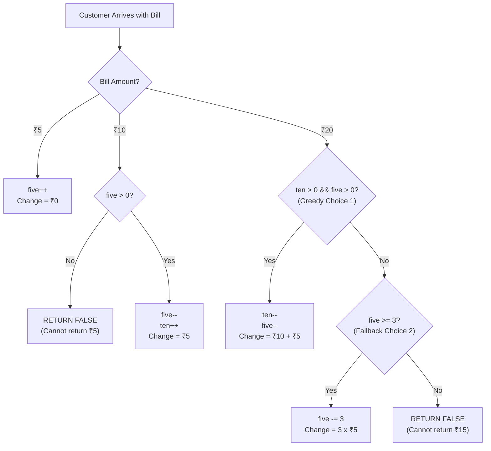

# Greedy Algorithms: Core Intuition, Patterns & Placement Problems

> **Aptitude & DSA revision notes** for campus placement coding rounds and technical interviews, including TCS NQT (Hands-on Coding / Digital / Prime), Infosys (DSE/SP), Cognizant, Wipro, Accenture, and LeetCode. Formulas, step-by-step models, analogies, dry runs, and clean Java implementations are written in GitHub-compatible Markdown/LaTeX.

## Table of Contents
1. [Core Intuition & The Greedy Philosophy](#1-core-intuition--the-greedy-philosophy)
   - [The Core Rule of Greedy](#the-core-rule-of-greedy)
   - [The Chaiwala Analogy (Why Greedy Works)](#the-chaiwala-analogy-why-greedy-works)
2. [Greedy vs. Dynamic Programming: The "Regret" (Pachtawa) Test](#2-greedy-vs-dynamic-programming-the-regret-pachtawa-test)
   - [The Buffet Analogy (When Greedy Fails)](#the-buffet-analogy-when-greedy-fails)
   - [The Twist: When Sorting Enables Greedy](#the-twist-when-sorting-enables-greedy)
   - [The Packing Bags Analogy](#the-packing-bags-analogy)
   - [Decision Matrix: Greedy vs. DP vs. Backtracking](#decision-matrix-greedy-vs-dp-vs-backtracking)
3. [Problem 1: Lemonade Change (LeetCode 860)](#3-problem-1-lemonade-change-leetcode-860)
   - [Problem Definition & Mathematical Invariant](#problem-definition--mathematical-invariant)
   - [Step-by-Step State Transitions](#step-by-step-state-transitions)
   - [Dry-Run Trace: Greedy Priority vs. Bad Choice](#dry-run-trace-greedy-priority-vs-bad-choice)
   - [Complete Java Implementation](#complete-java-implementation-lemonade-change)
4. [Problem 2: Assign Cookies (LeetCode 455)](#4-problem-2-assign-cookies-leetcode-455)
   - [Problem Definition & The Task Analogy](#problem-definition--the-task-analogy)
   - [Two-Pointer Greedy Matching Strategy](#two-pointer-greedy-matching-strategy)
   - [Step-by-Step Dry Run](#step-by-step-dry-run-assign-cookies)
   - [Complete Java Implementation](#complete-java-implementation-assign-cookies)
5. [Problem 3: Jump Game (LeetCode 55)](#5-problem-3-jump-game-leetcode-55)
   - [The "Town Guide" Analogy & Reach Framework](#the-town-guide-analogy--reach-framework)
   - [Step-by-Step Reach Invariant](#step-by-step-reach-invariant)
   - [Trace Dry Runs: Success vs. Dead End](#trace-dry-runs-success-vs-dead-end)
   - [Complete Java Implementation](#complete-java-implementation-jump-game)
6. [Problem 4: Fractional Knapsack (Standard Interview Problem)](#6-problem-4-fractional-knapsack-standard-interview-problem)
   - [0/1 Knapsack (DP) vs. Fractional Knapsack (Greedy)](#01-knapsack-dp-vs-fractional-knapsack-greedy)
   - [Unitary Ratio Heuristic: Price per Kilogram](#unitary-ratio-heuristic-price-per-kilogram)
   - [Step-by-Step Mathematical Derivation & Trace](#step-by-step-mathematical-derivation--trace)
   - [Complete Java Implementation](#complete-java-implementation-fractional-knapsack)
7. [Placement Strategy, Interview Heuristics & Common Traps](#7-placement-strategy-interview-heuristics--common-traps)
   - [Why Greedy Matters for Campus Placements](#why-greedy-matters-for-campus-placements)
   - [What You Should Do in an Interview](#what-you-should-do-in-an-interview)
   - [What You Should Avoid](#what-you-should-avoid)
   - [The Next Practical Step: Jump Game II (LeetCode 45)](#the-next-practical-step-jump-game-ii-leetcode-45)
8. [Practice Problems: Homework Solutions](#8-practice-problems-homework-solutions)
9. [Quick Formula & Concept Cheat Sheet](#9-quick-formula--concept-cheat-sheet)

---

## 1. Core Intuition & The Greedy Philosophy

### The Core Rule of Greedy

$$
\Large
\boxed{\text{"Abhi jo sabse accha choice lag raha hai wo karo, aur ant mein sab kuch theek ho jayega"}}
$$

A **Greedy Algorithm** builds up a solution piece by piece, always choosing the next piece that offers the most immediate (local) benefit, under the fundamental mathematical guarantee that:
1. **Local Optimal Choice $\implies$ Global Optimal Solution**.
2. **Zero Regret (No Pachtawa):** Choosing the current best option never penalizes, blocks, or invalidates a better future choice.

> [!IMPORTANT]
> **The Golden Invariant:** If choosing an option today can make you regret your choice tomorrow, the problem **CANNOT** be solved greedily. It requires exhaustive exploration via Dynamic Programming (DP) or Backtracking.

---

### The Chaiwala Analogy (Why Greedy Works)

**Scenario:** A train chaiwala sells hot tea for $\mathbf{\text{₹}10}$ per cup. In his cash bag, he carries coins and notes in denominations of:
$$
\Large
\text{Denominations} = \{\text{₹}5, \text{₹}10, \text{₹}20, \text{₹}50, \text{₹}100\}
$$

A customer buys one $\text{₹}10$ tea and hands over a $\text{₹}100$ note. The chaiwala must return $\mathbf{\text{₹}90}$ in change.

**Three Possible Ways to Return ₹90:**
1. Nine $\text{₹}10$ notes:
   $$
   9 \times 10 = \text{₹}90
   $$
2. Four $\text{₹}20$ notes $+$ One $\text{₹}10$ note:
   $$
   (4 \times 20) + (1 \times 10) = 80 + 10 = \text{₹}90
   $$
3. One $\text{₹}50$ note $+$ Two $\text{₹}20$ notes:
   $$
   (1 \times 50) + (2 \times 20) = 50 + 40 = \text{₹}90
   $$

#### Why Choice 3 is the Mathematically Optimal Greedy Choice:
- The chaiwala gets rid of the **largest denomination notes ($\text{₹}50, \text{₹}20$) first** and preserves his small chillar ($\text{₹}5, \text{₹}10$).
- **Flexibility Invariant:** A $\text{₹}10$ note can do everything a $\text{₹}10$ note does, but it can also be combined to make $\text{₹}20, \text{₹}30, \text{₹}40$. Conversely, a $\text{₹}50$ note is rigid—if the next customer gives $\text{₹}20$ for a $\text{₹}10$ tea and needs $\text{₹}10$ back, a $\text{₹}50$ note is completely useless!
- **Greedy Rule:** Always dispense the least flexible (largest) resources first, saving the most versatile (smallest) resources for the unknown future.

---

## 2. Greedy vs. Dynamic Programming: The "Regret" (Pachtawa) Test

### The Buffet Analogy (When Greedy Fails)

Imagine you enter a lavish wedding buffet where the host enforces a strict rule: **You may consume exactly ONE dish for free**, and the manager walks you forward along a one-way corridor without allowing you to peek ahead.

```text
[Stall 1: Veg Pulao] ──> [Stall 2: Mutton Biryani] ──> [Stall 3: Royal Shahi Paneer]
       │
   You get greedy
   and eat Pulao!
       │
       ▼
  Arrival at Stall 2: Pachtawa (Regret)! Mutton Biryani was far superior, but you cannot change your past choice.
```

> [!WARNING]
> **The Regret Heuristic:**
> Jahan **pachtawa (regret)** hone ka $1\%$ bhi chance ho, wahan Greedy **kabhi mat lagana**—wahan **Dynamic Programming (DP)** lagega (such as the *House Robber* or *0/1 Knapsack* problem).

---

### The Twist: When Sorting Enables Greedy

What if the manager changes the rule:
> *"Pehle poora buffet ghoom aao, inspect all dishes, sort them by tastiness/value, and then make your pick."*

Now, with global visibility obtained via **Sorting ($\mathcal{O}(N \log N)$)**:
1. You inspect everything.
2. You pick the absolute best item (Mutton Biryani).
3. **Pachtawa = Zero.**

> [!TIP]
> In coding interviews, **90% of Greedy problems require sorting the input first**. Sorting converts an uncertain future into a known, monotonic sequence, eliminating future regret!

---

### The Packing Bags Analogy

When packing suitcases for a flight with strict baggage limits:
- Your father selects the **largest bag first** and packs it to maximum density before opening a second bag.
- Why? Filling the biggest container first minimizes the total number of bags carried and leaves smaller, versatile bags for quick-access items. Greedily exhausting the largest container first never impairs future choices.

---

### Decision Matrix: Greedy vs. DP vs. Backtracking

| Paradigm | When to Use | State Guarantee | Time Complexity | Auxiliary Space |
| :--- | :--- | :--- | :--- | :--- |
| **Greedy** | Local choice is globally optimal; Zero regret | irreversible forward steps | $\mathcal{O}(N)$ or $\mathcal{O}(N \log N)$ | $\mathcal{O}(1)$ |
| **Dynamic Programming (DP)** | Overlapping subproblems; Future choices depend on past state | Stores optimal sub-results in cache / table | $\mathcal{O}(N^2)$ or $\mathcal{O}(N \times W)$ | $\mathcal{O}(N)$ or $\mathcal{O}(N \times W)$ |
| **Backtracking** | Need to discover ALL valid configurations (permutations, subsets) | Reversible trial-and-error | $\mathcal{O}(2^N)$ or $\mathcal{O}(N!)$ | $\mathcal{O}(N)$ (call stack) |

---

## 3. Problem 1: Lemonade Change (LeetCode 860)

### Problem Definition & Mathematical Invariant

- **Cost of Lemonade:** $\text{₹}5$ per glass.
- **Bill Denominations Received:** $\text{₹}5$, $\text{₹}10$, or $\text{₹}20$.
- **Starting Cash in Register:** $\text{₹}0$.
- **Goal:** Return `true` if exact change can be provided to every customer in the queue, or `false` the instant change cannot be returned.

$$
\Large
\boxed{\text{Change Needed} = \text{Bill Received} - 5}
$$

- Customer pays $\text{₹}5 \implies \text{Change} = 0$.
- Customer pays $\text{₹}10 \implies \text{Change} = 5$.
- Customer pays $\text{₹}20 \implies \text{Change} = 15$.

> [!NOTE]
> **Why we NEVER track ₹20 bills:**
> A $\text{₹}20$ bill cannot be used to return change for $\text{₹}5$ or $\text{₹}15$. It is a dead asset in our cash register:
> *"₹20 kisi kaam ka nahi hai change dene ke liye."*
> Hence, we only maintain two integer registers: `five` and `ten`.

---

### Step-by-Step State Transitions



1. **Customer pays ₹5:**
   Keep it in the register: `five++`.
2. **Customer pays ₹10:**
   Must return $\text{₹}5$.
   - If `five == 0`, immediately return `false`.
   - Otherwise: `five--` and `ten++`.
3. **Customer pays ₹20 (Change needed = ₹15):**
   - **Choice 1 (Greedy Priority):** Give one $\text{₹}10$ and one $\text{₹}5$ note (`ten--`, `five--`). Always attempt this first!
   - **Choice 2 (Fallback):** Give three $\text{₹}5$ notes (`five -= 3`) only if `ten == 0`.
   - If neither condition can be met: return `false`.

---

### Dry-Run Trace: Greedy Priority vs. Bad Choice

Suppose the register currently holds:
$$
\text{ten} = 1, \quad \text{five} = 3
$$

Customer 1 pays $\mathbf{\text{₹}20}$ (requires $\text{₹}15$ change):

| Strategy | Action Taken | Resulting Pocket State | Next Customer 2 Pays ₹10 (Needs ₹5) | Outcome |
| :--- | :--- | :--- | :--- | :--- |
| **Bad Choice (Wasting ₹5s)** | Return three $\text{₹}5$ notes | $\text{ten} = 1, \;\; \mathbf{\text{five} = 0}$ | Needs $\text{₹}5$, but $\text{five} == 0$ | ❌ **FAIL (`false`)** |
| **Greedy Choice (Save ₹5s)** | Return one $\text{₹}10$ + one $\text{₹}5$ | $\text{ten} = 0, \;\; \mathbf{\text{five} = 2}$ | Needs $\text{₹}5$, gives one $\text{₹}5$ ($\text{five} = 1$) | ✅ **SUCCESS (`true`)** |

---

### Complete Java Implementation (Lemonade Change)

```java
class Solution {
    public boolean lemonadeChange(int[] bills) {
        int five = 0; // Tracks count of ₹5 notes
        int ten = 0;  // Tracks count of ₹10 notes (₹20 track karne ki zarurat nahi hai)

        for (int i = 0; i < bills.length; i++) {
            int money = bills[i];

            if (money == 5) {
                five++; // ₹5 mila, seedha jeb mein rakho
            } else if (money == 10) {
                if (five == 0) {
                    return false; // ₹5 wapas karne ke liye chillar nahi hai
                }
                five--;
                ten++;
            } else { // money == 20 (Need to return ₹15 change)
                // Choice 1 (Greedy): Try giving one ₹10 and one ₹5 first
                if (ten > 0 && five > 0) {
                    ten--;
                    five--;
                } 
                // Choice 2 (Fallback): Give three ₹5 notes
                else if (five >= 3) {
                    five -= 3;
                } 
                // Neither choice possible
                else {
                    return false;
                }
            }
        }
        return true;
    }
}
```

- **Time Complexity:** $\mathcal{O}(N)$ where $N$ is the number of customers (single pass).
- **Space Complexity:** $\mathcal{O}(1)$ auxiliary space (two scalar integer variables).

---

## 4. Problem 2: Assign Cookies (LeetCode 455)

### Problem Definition & The Task Analogy

- **Given:**
  - An integer array `child[]`, where `child[i]` represents the **greed factor** (minimum cookie size demanded by child $i$).
  - An integer array `cookie[]`, where `cookie[j]` represents the **size** of cookie $j$.
- **Rule:** Each child can receive at most one cookie. A child is satisfied if and only if $\text{cookie}[j] \ge \text{child}[i]$.
- **Goal:** Maximize the total number of content (happy) children.

#### The Productivity Analogy:
> If your goal is to finish the maximum number of daily tasks, you don't start your morning with a 2.5-hour grueling workout and faint from exhaustion. You knock out quick, low-effort tasks first: take a bath, eat breakfast, read 5 pages ($3 \text{ tasks} > 1 \text{ task}$).
> Similarly: **Jis bacche ka lalach (greed) sabse kam hai, usko khush karna sabse aasan hai!**

---

### Two-Pointer Greedy Matching Strategy

$$
\Large
\boxed{\text{Sort } \mathbf{child[]} \text{ and } \mathbf{cookie[]} \text{ in Ascending Order}}
$$

1. **Sort both arrays:**
   - Gives least greedy child first.
   - Gives smallest available cookie first.
2. **Two Pointers:**
   - Pointer `i = 0` on `child[]`.
   - Pointer `j = 0` on `cookie[]`.
3. **Greedy Decision Logic:**
   - **Case 1: `cookie[j] >= child[i]`**
     The cookie satisfies the child. Give it!
     - `result++`
     - `i++` (Move to next child)
     - `j++` (Cookie is consumed, move to next cookie)
   - **Case 2: `cookie[j] < child[i]`**
     If this cookie cannot even satisfy the least greedy child currently waiting, it can **never** satisfy any hungrier child further down the line!
     - Discard this small cookie: `j++`.
     - Keep `i` waiting on the same child.

---

### Step-by-Step Dry Run (Assign Cookies)

- **Input:** `child = [1, 5, 3]`, `cookie = [4, 2]`
- **After Sorting:**
  $$
  \text{child} = [1, 3, 5], \qquad \text{cookie} = [2, 4]
  $$

```text
Step 1: i = 0 (Child A wants 1), j = 0 (Cookie is 2)
        2 >= 1 --> Satisfied! Don't waste the 4kg cookie here.
        result = 1, i = 1, j = 1

Step 2: i = 1 (Child B wants 3), j = 1 (Cookie is 4)
        4 >= 3 --> Satisfied!
        result = 2, i = 2, j = 2

Loop Terminates: j == cookie.length (No more cookies left).
Final Result = 2 happy children.
```

---

### Complete Java Implementation (Assign Cookies)

```java
import java.util.Arrays;

class Solution {
    public int findContentChildren(int[] child, int[] cookie) {
        // Step 1: Sort both arrays in ascending order
        Arrays.sort(child);
        Arrays.sort(cookie);

        int i = 0; // Pointer for children
        int j = 0; // Pointer for cookies
        int result = 0;

        // Step 2: Two-pointer greedy traversal
        while (i < child.length && j < cookie.length) {
            if (cookie[j] >= child[i]) {
                result++; // Baccha khush ho gaya
                i++;      // Move to next child
                j++;      // Cookie khatam, move to next cookie
            } else {
                // Yeh cookie chota pad gaya, bada cookie dhoondo
                j++;
            }
        }

        return result;
    }
}
```

- **Time Complexity:** $\mathcal{O}(N \log N + M \log M)$ due to dual sorting ($N = \text{children}, M = \text{cookies}$). The two-pointer traversal takes linear time $\mathcal{O}(N + M)$.
- **Space Complexity:** $\mathcal{O}(1)$ or $\mathcal{O}(\log N + \log M)$ auxiliary stack space for sorting.

---

## 5. Problem 3: Jump Game (LeetCode 55)

### The "Town Guide" Analogy & Reach Framework

**Problem Statement:** You are given an integer array `nums` where `nums[i]` denotes the maximum jump length from index $i$. Starting at index $0$, return `true` if you can reach the last index ($n - 1$), or `false` otherwise.

#### Why Beginners Think of DP (And Why DP is Overkill):
At index $0$ with `nums[0] = 2`, you can jump to index $1$ or index $2$. Beginners try to explore all branch combinations recursively using DP with memoization ($\mathcal{O}(N^2)$).

#### The Town Analogy:
Imagine each index $i$ is a **Town**, and `nums[i]` is a local guide living in that town who knows the road map up to:
$$
\Large
\text{Max Destination from Town } i = i + \text{nums}[i]
$$

- You do **not** skip towns blindly. You walk forward through every single town sequentially: $i = 0, 1, 2, \dots$
- Maintain a single variable: **`reach`** (the furthest town you have the map/knowledge to reach).

---

### Step-by-Step Reach Invariant

$$
\Large
\boxed{\text{In each town } i: \quad \text{If } \mathbf{reach < i} \implies \text{DEAD END! Return } \mathbf{false}}
$$

1. **Check Validity:** Can we even reach town $i$?
   - If `reach < i`: You never had enough fuel/knowledge to reach this point. You are stranded. Return `false`!
2. **Update Knowledge:** Ask the town guide: *"Tum humko maximum kahan tak pahuncha sakte ho?"*
   $$
   \Large
   \boxed{\text{reach} = \max(\text{reach}, \; i + \text{nums}[i])}
   $$
3. **Early Exit:**
   If $\text{reach} \ge n - 1$, you can already reach the final destination! Return `true`.

---

### Trace Dry Runs: Success vs. Dead End

#### Case 1 (Success): `nums = [2, 3, 1, 1, 4]` ($n = 5$, Target index $= 4$)

| Town $i$ | `nums[i]` | Check `reach < i` | Guide Knowledge ($i + \text{nums}[i]$) | Updated `reach` | Status |
| :---: | :---: | :---: | :---: | :---: | :--- |
| **Start** | — | — | — | $\text{reach} = 0$ | Start at Town 0 |
| **$i = 0$** | 2 | $0 < 0$ (False) | $0 + 2 = 2$ | $\max(0, 2) = \mathbf{2}$ | Reached Town 0 |
| **$i = 1$** | 3 | $2 < 1$ (False) | $1 + 3 = 4$ | $\max(2, 4) = \mathbf{4}$ | $\text{reach} \ge 4 \implies$ **RETURN TRUE** 🎉 |

---

#### Case 2 (Dead End): `nums = [1, 0, 2]` ($n = 3$, Target index $= 2$)

| Town $i$ | `nums[i]` | Check `reach < i` | Guide Knowledge ($i + \text{nums}[i]$) | Updated `reach` | Status |
| :---: | :---: | :---: | :---: | :---: | :--- |
| **Start** | — | — | — | $\text{reach} = 0$ | Start at Town 0 |
| **$i = 0$** | 1 | $0 < 0$ (False) | $0 + 1 = 1$ | $\max(0, 1) = \mathbf{1}$ | Reached Town 0 |
| **$i = 1$** | 0 | $1 < 1$ (False) | $1 + 0 = 1$ | $\max(1, 1) = \mathbf{1}$ | Reached Town 1 |
| **$i = 2$** | 2 | $\mathbf{1 < 2}$ **(TRUE!)** | — | — | ❌ **DEAD END! RETURN FALSE** |

You only had knowledge to reach up to Town 1. You can never step foot into Town 2.

---

### Complete Java Implementation (Jump Game)

```java
class Solution {
    public boolean canJump(int[] nums) {
        int n = nums.length;
        int reach = 0; // Shuru mein humari knowledge (reach) sirf Town 0 tak hai

        for (int i = 0; i < n; i++) {
            // Step 1: Check if we even had the reach to arrive at Town i
            if (reach < i) {
                return false; // Dead end! Yahan tak aane ka rasta hi nahi pata tha
            }

            // Step 2: Ask the person in Town i how far they can send us
            reach = Math.max(reach, i + nums[i]);

            // Step 3: If our reach covers the last town, we succeeded early
            if (reach >= n - 1) {
                return true;
            }
        }

        return true;
    }
}
```

- **Time Complexity:** $\mathcal{O}(N)$ single linear scan.
- **Space Complexity:** $\mathcal{O}(1)$ auxiliary space (single integer accumulator).

---

## 6. Problem 4: Fractional Knapsack (Standard Interview Problem)

### 0/1 Knapsack (DP) vs. Fractional Knapsack (Greedy)

You possess a sack (potli) with a maximum weight capacity:
$$
W = 50\text{ kg}
$$

| Knapsack Type | Breakable Items? | Applicable Technique | Why Greedy Works / Fails |
| :--- | :--- | :--- | :--- |
| **0/1 Knapsack** | **NO** (Must take 100% or 0%) | **Dynamic Programming** ($\mathcal{O}(N \times W)$) | Taking a bulky high-value item greedily might leave awkward empty space that cannot be filled. |
| **Fractional Knapsack** | **YES** (Aap item ko tod sakte ho!) | **Greedy Algorithm** ($\mathcal{O}(N \log N)$) | You can fill 100% of the bag's capacity with the highest price-per-kg materials. |

#### The Kesar (Saffron) vs. Loha (Iron) Analogy:
- If a shop has $1\text{ kg}$ of Kesar (₹1,00,000/kg) and $50\text{ kg}$ of Iron (₹50/kg), you don't look at total item weight or total bundle price.
- You look at the **unit rate (Price per 1 kg)**! You fill as much Kesar as possible, and then top up the rest with the next best rate item.

---

### Unitary Ratio Heuristic: Price per Kilogram

$$
\Large
\boxed{\text{Ratio} = \frac{\text{Value}_i}{\text{Weight}_i}}
$$

1. Calculate the price-per-kg ratio for every item.
2. Sort all items in **descending order of ratio**.
3. Iterate through sorted items:
   - If item weight fits in remaining bag capacity: take the whole item!
   - If item weight exceeds remaining bag capacity: take the exact fractional weight needed to fill the bag using the unitary method:
     $$
     \Large
     \boxed{\text{Fractional Value} = \left(\frac{\text{Value}_i}{\text{Weight}_i}\right) \times \text{Remaining Capacity}}
     $$

---

### Step-by-Step Mathematical Derivation & Trace

**Given Data:**
- Bag Capacity $W = 50\text{ kg}$.
- Items:
  - Item 1: Value $= \text{₹}60$, Weight $= 10\text{ kg}$
  - Item 2: Value $= \text{₹}100$, Weight $= 20\text{ kg}$
  - Item 3: Value $= \text{₹}120$, Weight $= 30\text{ kg}$

#### Sorting by Unitary Ratio:
| Item | Value ($\text{₹}$) | Weight ($\text{kg}$) | Unit Ratio ($\text{₹}/\text{kg}$) | Priority Order |
| :---: | :---: | :---: | :---: | :---: |
| **Item 1** | 60 | 10 | $\frac{60}{10} = \mathbf{6.0}$ | **1st (Highest value per kg)** |
| **Item 2** | 100 | 20 | $\frac{100}{20} = \mathbf{5.0}$ | **2nd** |
| **Item 3** | 120 | 30 | $\frac{120}{30} = \mathbf{4.0}$ | **3rd** |

#### Step-by-Step Packing:
- **Step 1: Pick Item 1 (Ratio 6.0)**
  - Weight required: $10\text{ kg} \le 50\text{ kg}$. Take completely!
  - $\text{Remaining Capacity} = 50 - 10 = \mathbf{40\text{ kg}}$
  - $\text{Total Value} = \mathbf{\text{₹}60}$

- **Step 2: Pick Item 2 (Ratio 5.0)**
  - Weight required: $20\text{ kg} \le 40\text{ kg}$. Take completely!
  - $\text{Remaining Capacity} = 40 - 20 = \mathbf{20\text{ kg}}$
  - $\text{Total Value} = 60 + 100 = \mathbf{\text{₹}160}$

- **Step 3: Pick Item 3 (Ratio 4.0)**
  - Weight required: $30\text{ kg}$, but bag only has $20\text{ kg}$ left!
  - Break Item 3 and take a $20\text{ kg}$ fraction:
    $$
    \Large
    \text{Value} = \left(\frac{120}{30}\right) \times 20 = 4.0 \times 20 = \mathbf{\text{₹}80}
    $$
  - $\text{Remaining Capacity} = 20 - 20 = \mathbf{0\text{ kg}}$
  - Final Total Value:
    $$
    \Large
    \boxed{\text{Total Optimal Value} = 160 + 80 = \mathbf{\text{₹}240.0}}
    $$

---

### Complete Java Implementation (Fractional Knapsack)

```java
import java.util.Arrays;

class Item {
    int value, weight;
    Item(int value, int weight) {
        this.value = value;
        this.weight = weight;
    }
}

class Solution {
    public double fractionalKnapsack(int capacity, Item[] items) {
        // Step 1: Sort items in descending order of (value / weight) ratio
        // Use Double.compare with cross-multiplication or double cast to prevent integer truncation
        Arrays.sort(items, (a, b) -> 
            Double.compare((double) b.value / b.weight, (double) a.value / a.weight)
        );

        double totalValue = 0.0;
        int remainingCapacity = capacity;

        // Step 2: Pick items greedily
        for (Item item : items) {
            if (remainingCapacity == 0) break;

            // If we can take the whole item, take it completely
            if (item.weight <= remainingCapacity) {
                totalValue += item.value;
                remainingCapacity -= item.weight;
            } 
            // Otherwise, break the item and take whatever fraction fits
            else {
                double valuePerKg = (double) item.value / item.weight;
                totalValue += valuePerKg * remainingCapacity;
                remainingCapacity = 0; // Knapsack is now 100% full
            }
        }

        return totalValue;
    }
}
```

- **Time Complexity:** $\mathcal{O}(N \log N)$ to sort $N$ items. The greedy packing loop takes $\mathcal{O}(N)$.
- **Space Complexity:** $\mathcal{O}(1)$ auxiliary space (excluding input/sorting stack).

---

## 7. Placement Strategy, Interview Heuristics & Common Traps

### Why Greedy Matters for Campus Placements
- **Frequent OA & Interview Assessment:** Greedy problems are universally favored in Round 1 Online Assessments (OA) and Round 2 Technical Interviews (TCS Digital, TCS Prime, Infosys DSE, Cognizant, Wipro).
- **Tests Problem-Solving Instinct:** They determine whether you can detect invariants and avoid unnecessary, expensive algorithms like 2D Dynamic Programming.
- **Extreme Efficiency:** Almost all Greedy solutions run in $\mathcal{O}(N)$ or $\mathcal{O}(N \log N)$ time with $\mathcal{O}(1)$ space, passing strict placement time limits effortlessly.

---

### What You Should Do in an Interview

1. **Conduct the "Regret" (Pachtawa) Test:**
   Ask yourself: *"If I make this local choice now, is there any input sequence where this choice will block a superior global option?"*
2. **Attempt to Construct Counter-Examples:**
   Spend 60 seconds trying to break your greedy hypothesis with a small test array (e.g. $[2, 3, 1, \dots]$). If you cannot find any counter-example, Greedy is likely the intended optimal approach.
3. **Sort to Enforce Monotonicity:**
   If the elements appear in disordered fashion, check if sorting by start time, end time, ratio, or magnitude reveals the greedy choice.

---

### What You Should Avoid

> [!WARNING]
> - **Never blindly jump to DP tables:** Do not write recursive memoization or DP state tables for problems like *Jump Game* or *Lemonade Change*. An $\mathcal{O}(N)$ greedy loop is what distinguishes a top-tier candidate from an average applicant.
> - **Integer Division Truncation:** When computing ratios like $\frac{\text{value}}{\text{weight}}$, writing `int ratio = a.value / a.weight;` yields `0` for any fraction $< 1$. Always cast to `double` or cross-multiply:
>   $$
>   \frac{v_1}{w_1} > \frac{v_2}{w_2} \iff v_1 \times w_2 > v_2 \times w_1
>   $$
> - **Forgetting Invariants:** Forgetting to prioritize $\text{₹}10 + \text{₹}5$ over three $\text{₹}5$ notes in Lemonade Change will cause subtle test-case failures on LeetCode.

---

### The Next Practical Step: Jump Game II (LeetCode 45)

In **Jump Game I (LC 55)**, you verified **reachability** (`true`/`false`).
In **Jump Game II (LC 45)**, your objective is to find the **minimum number of jumps** to reach index $n - 1$.

```text
Jump Game II Greedy BFS Window Concept:
Current Jump Level: [ 0 ]
Next Level Reachable: [ 1 ... maxReachFromLevel0 ]
Jumps increment by 1 each time you exhaust the current window boundary!
```

---

## 8. Practice Problems: Homework Solutions

### Homework Problem 1: Gas Station / Circular Tour (LeetCode 134)

**Problem Statement:**
There are $N$ gas stations along a circular route. Station $i$ provides `gas[i]` fuel, and the cost to travel from station $i$ to $(i + 1)$ is `cost[i]`. Return the starting station index if you can travel around the circuit once, or `-1`.

**Step 1: Check Global Solvability**
$$
\Large
\text{Total Surplus} = \sum_{i=0}^{N-1} (\text{gas}[i] - \text{cost}[i])
$$
If $\text{Total Surplus} < 0$, it is impossible to complete the loop from any station. Return `-1`.

**Step 2: Greedy Starting Point Invariant**
Maintain `currentTank = 0` and `start = 0`.
At each station $i$:
$$
\text{currentTank} += \text{gas}[i] - \text{cost}[i]
$$
If $\text{currentTank} < 0$, it means **no station between `start` and $i$ can be the answer**!
Reset: `start = i + 1` and `currentTank = 0`.

**Final Answer:**
The starting station index is $\Large \boxed{\mathbf{start}}$.
- **Time Complexity:** $\mathcal{O}(N)$
- **Space Complexity:** $\mathcal{O}(1)$

---

### Homework Problem 2: Non-overlapping Intervals (LeetCode 435)

**Problem Statement:**
Given an array of intervals `intervals[i] = [start, end]`, find the minimum number of intervals you need to remove to make the rest non-overlapping.

**Step 1: The Greedy Criterion**
To leave the maximum space for future intervals, always prioritize intervals that **finish earliest**!
Sort intervals by their **end time**: `intervals.sort((a, b) -> a[1] - b[1])`.

**Step 2: Greedy Selection**
Keep track of the `prevEnd` of the last selected non-overlapping interval.
For each interval:
- If $\text{start} \ge \text{prevEnd}$: No overlap. Update $\text{prevEnd} = \text{end}$.
- If $\text{start} < \text{prevEnd}$: Overlap detected! Greedily remove this interval (`removals++`).

**Final Answer:**
The minimum intervals to remove is $\Large \boxed{\mathbf{removals}}$.
- **Time Complexity:** $\mathcal{O}(N \log N)$
- **Space Complexity:** $\mathcal{O}(1)$

---

## 9. Quick Formula & Concept Cheat Sheet

| Concept / Problem | Core Rule / Mathematical Formula | Greedy Choice Property | Time Complexity | Auxiliary Space |
| :--- | :--- | :--- | :---: | :---: |
| **Greedy Golden Rule** | Local optimal choice leads to global optimum without regret | Pick best local option right now | $\mathcal{O}(N)$ or $\mathcal{O}(N \log N)$ | $\mathcal{O}(1)$ |
| **Lemonade Change** | $\text{Change for } \text{₹}20 = \text{₹}10 + \text{₹}5$ (Priority) | Save versatile $\text{₹}5$ notes; give rigid $\text{₹}10$ first | $\mathcal{O}(N)$ | $\mathcal{O}(1)$ |
| **Assign Cookies** | Smallest cookie $\ge$ least greed factor | Satisfy least greedy child with smallest possible cookie | $\mathcal{O}(N \log N + M \log M)$ | $\mathcal{O}(1)$ |
| **Jump Game I** | $\text{reach} = \max(\text{reach}, \; i + \text{nums}[i])$ | Expand knowledge frontier; dead end if $\text{reach} < i$ | $\mathcal{O}(N)$ | $\mathcal{O}(1)$ |
| **Fractional Knapsack** | Unitary Ratio $= \frac{\text{Value}_i}{\text{Weight}_i}$ | Sort descending by ratio; take fractional top-up | $\mathcal{O}(N \log N)$ | $\mathcal{O}(1)$ |
| **Activity Selection** | Sort intervals by **finish time** (`end`) | Earliest finishing activity leaves maximum remaining time | $\mathcal{O}(N \log N)$ | $\mathcal{O}(1)$ |
| **Gas Station** | $\text{currentTank} < 0 \implies \text{start} = i + 1$ | If cumulative deficit occurs, reset starting candidate | $\mathcal{O}(N)$ | $\mathcal{O}(1)$ |

*Revision tip: Before jumping into code for any optimization question in TCS NQT or technical interviews, ask: "Can I sort the input, and does choosing the maximum/minimum right now cause zero future regret?" If yes, apply Greedy in $\mathcal{O}(N)$ or $\mathcal{O}(N \log N)$.*
