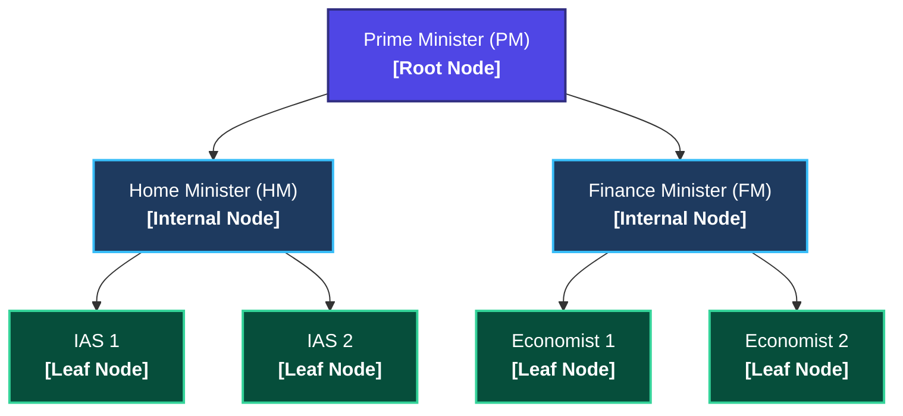
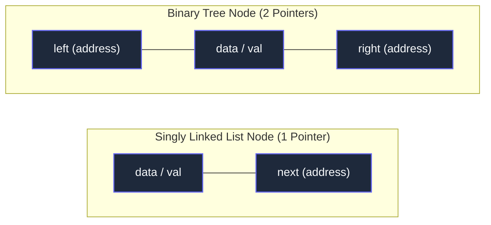
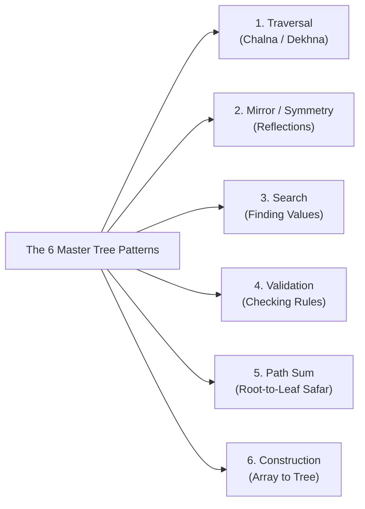

# Trees 01: Why Trees Matter & Core Intuition (Simple → Practical)

> **DSA Master Revision Notes** for campus placements and technical interviews (TCS NQT Hands-on Coding / Digital / Prime, Infosys DSE/SP, Cognizant, Wipro, Accenture, LeetCode). Based on Episode 01 of the Tree Series by **Padho with Pratyush**. Formatted with GitHub-compatible Markdown, KaTeX mathematics, visual ASCII/Mermaid trees, and verified Java implementations.

---

## Table of Contents
1. [Part 1: Why Trees Matter & Core Intuition (Simple $\to$ Practical)](#part-1-why-trees-matter--core-intuition-simple--practical)
   - [1. Why Trees are the Gateway to High-Paying Jobs](#1-why-trees-are-the-gateway-to-high-paying-jobs)
   - [2. The Indian Politics Analogy (What is a Tree in Real Life?)](#2-the-indian-politics-analogy-what-is-a-tree-in-real-life)
   - [3. Essential Tree Terminologies (Explained via the Analogy)](#3-essential-tree-terminologies-explained-via-the-analogy)
2. [Part 2: Binary Tree & Memory Representation (Practical Level)](#part-2-binary-tree--memory-representation-practical-level)
   - [1. How to Identify a Tree Question in an Interview?](#1-how-to-identify-a-tree-question-in-an-interview)
   - [2. What is a Binary Tree?](#2-what-is-a-binary-tree)
   - [3. How is a Tree Stored in Memory? (Linked List vs. Binary Tree)](#3-how-is-a-tree-stored-in-memory-linked-list-vs-binary-tree)
3. [Part 3: Complete Java Code & Syntax Steps](#part-3-complete-java-code--syntax-steps)
   - [Complete `TreeBasics.java` Implementation](#complete-treebasicsjava-implementation)
   - [Quick Comparison Table: Linked List vs. Binary Tree in Java](#quick-comparison-table-linked-list-vs-binary-tree-in-java)
4. [Part 4: The 6 Master Patterns of Trees (Interview Roadmap)](#part-4-the-6-master-patterns-of-trees-interview-roadmap)
   - [Pattern 1: Traversal (Chalna / Dekhna)](#pattern-1-traversal-chalna--dekhna)
   - [Pattern 2: Mirror / Symmetry](#pattern-2-mirror--symmetry)
   - [Pattern 3: Search](#pattern-3-search)
   - [Pattern 4: Validation](#pattern-4-validation)
   - [Pattern 5: Path Sum (Root-to-Leaf Safar)](#pattern-5-path-sum-root-to-leaf-safar)
   - [Pattern 6: Construction (Hardest)](#pattern-6-construction-hardest)
5. [Part 5: Actionable Interview & Career Takeaways](#part-5-actionable-interview--career-takeaways)
   - [Why this matters for your placements](#why-this-matters-for-your-placements)
   - [What you should do](#what-you-should-do)
   - [What you should avoid](#what-you-should-avoid)
   - [Your Next Practical Step](#your-next-practical-step)

---

## Part 1: Why Trees Matter & Core Intuition (Simple $\to$ Practical)

### 1. Why Trees are the Gateway to High-Paying Jobs
- **90% of students quit at Arrays:** Most beginners get stuck in Arrays/Strings and never reach Advanced DSA (Trees, Graphs, Dynamic Programming, Tries).
- **Easiest Advanced DSA Topic:** Among Advanced DSA topics:
  $$
  \Large
  \boxed{\text{Tree} \ < \ \text{Graph} \ < \ \text{DP} \ < \ \text{Segment Tree / Trie}}
  $$
  Tree is the **easiest** and the **most frequently asked** in interviews for ₹10+ LPA roles (Google, Amazon, Microsoft, TCS Prime/Digital).
- **Prerequisites:** Trees heavily rely on **Linked List** (node pointers) and **Recursion**.

---

### 2. The Indian Politics Analogy (What is a Tree in Real Life?)
You will never see an Array walking around in real life, but Trees are everywhere wherever **hierarchy** exists. Think of the Indian Government hierarchy:



- **Non-Linear Structure:** Unlike an Array or Linked List (which goes in a single straight line), a Tree spreads out (*phailta jaata hai*) like a Christmas tree from top to bottom.
- **Reporting Rule:** IAS 1 does not barge directly into the PM's office. IAS 1 reports to the Home Minister, and the Home Minister reports to the PM.

---

### 3. Essential Tree Terminologies (Explained via the Analogy)

| Terminology | Government Entity | Plain-English Definition | Invariant / Code Condition |
| :--- | :--- | :--- | :--- |
| **Node** | Every individual official (PM, HM, IAS 1, etc.) | Data container holding value and child addresses | `TreeNode` with `data`, `left`, `right` |
| **Root Node** | **Prime Minister (PM)** | The topmost head where the entire tree originates | **Has NO Parent** (`PM reports to no one`) |
| **Children** | HM & FM (children of PM); IAS 1 & 2 (children of HM) | Nodes that branch directly downwards from a parent | Accessed via `root.left` or `root.right` |
| **Parent** | PM (parent of ministers); HM (parent of IAS officers) | The node directly above a given child | Points to child via `left` or `right` |
| **Leaf Nodes (Patte)** | **IAS 1, IAS 2, Economist 1, Economist 2** | The bottom-most terminals with NO children below | $\Large \boxed{\text{node.left} == \text{null} \ \land \ \text{node.right} == \text{null}}$ |

---

## Part 2: Binary Tree & Memory Representation (Practical Level)

### 1. How to Identify a Tree Question in an Interview?
Unlike Graphs or DP where you have to guess the pattern, **99.99% of Tree questions explicitly say:**
- *"Given a Binary Tree..."* or
- *"Given the root of a tree..."*
in the problem statement.

### 2. What is a Binary Tree?
- **Binary** means 2 (0 and 1).
- In a **Binary Tree**, every node can have **AT MOST 2 children** (0 children, 1 child, or 2 children—never 3 or more).
- Almost 100% of coding interview tree questions focus on **Binary Trees** (and Binary Search Trees).

### 3. How is a Tree Stored in Memory? (Linked List vs. Binary Tree)
A computer cannot draw circles and arrows in RAM. So how do we code a Tree? **Exactly like a Linked List!**
- **In a Singly Linked List:** Each node stores data and 1 pointer/address (`next`) pointing to the next node.
- **In a Binary Tree:** Since the PM has 2 subordinates (HM and FM), the PM node stores **2 addresses**:
  - `left` address: Points to the Left Child (Home Minister).
  - `right` address: Points to the Right Child (Finance Minister).



- **How a Leaf Node looks in Memory:**
  A Leaf Node still has data, but since it has no children, both its `left` and `right` pointers store `null`:
  $$
  [\ \text{null}\ |\ \text{data}\ |\ \text{null}\ ]
  $$

---

## Part 3: Complete Java Code & Syntax Steps

In every LeetCode or GFG problem, you are given the `root` node (just like you were given `head` in a Linked List). Here is how you define, navigate, and check nodes in Java:

### Complete `TreeBasics.java` Implementation

```java
// Step 1: How a Binary Tree Node (TreeNode) is defined in Java
class TreeNode {
    int data;          // Stores the actual value/number (often called 'val' on LeetCode)
    TreeNode left;     // Address/Reference to the Left Child
    TreeNode right;    // Address/Reference to the Right Child

    // Constructor to create a new node
    TreeNode(int data) {
        this.data = data;
        this.left = null;  // Initially no left child
        this.right = null; // Initially no right child
    }
}

public class TreeBasics {
    public static void main(String[] args) {
        // Step 2: Creating nodes manually (like the Politics Example)
        TreeNode root = new TreeNode(1);       // PM (Root)
        root.left = new TreeNode(2);           // Home Minister (Left Child)
        root.right = new TreeNode(3);          // Finance Minister (Right Child)
        root.left.left = new TreeNode(4);      // IAS 1 (Leaf Node)

        // Step 3: Essential Operations you will use in every Tree problem

        // A. Check if the Tree is completely empty
        if (root == null) {
            System.out.println("Tree khali hai (Empty Tree)!");
            return;
        }

        // B. Print the Root's data
        System.out.println("Root Data: " + root.data);

        // C. Move to the Left Child or Right Child (Just like temp = temp.next in Linked List)
        TreeNode leftChild = root.left;   // Moves to Left Child (2)
        TreeNode rightChild = root.right; // Moves to Right Child (3)

        // D. How to check if a node is a LEAF NODE (Very Important for Interviews!)
        TreeNode currentNode = root.left.left; // Node 4 (IAS 1)
        if (currentNode.left == null && currentNode.right == null) {
            System.out.println("Node " + currentNode.data + " ek Leaf Node hai (No children)!");
        }
    }
}
```

---

### Quick Comparison Table: Linked List vs. Binary Tree in Java

| Operation | Singly Linked List (`ListNode`) | Binary Tree (`TreeNode`) |
| :--- | :--- | :--- |
| **Starting Point Given** | `head` | `root` |
| **Access Value** | `head.val` or `head.data` | `root.val` or `root.data` |
| **Move Forward** | `temp = temp.next;` | `temp = root.left;` OR `temp = root.right;` |
| **End / Base Condition** | `temp.next == null` (Last Node) | `node.left == null && node.right == null` (Leaf Node) |
| **Empty Check** | `if (head == null)` | `if (root == null)` |

---

## Part 4: The 6 Master Patterns of Trees (Interview Roadmap)

The lecture outlines 6 core patterns that cover almost every Tree interview question:



### Pattern 1: Traversal (Chalna / Dekhna)
- Walking through every node of the tree to inspect or print values (just like a `for` loop in an array).
- Includes **Inorder**, **Preorder**, **Postorder** (DFS), and **Level Order** (BFS) traversals.

### Pattern 2: Mirror / Symmetry
- Given two trees (or left and right halves of one tree), check if they are exact mirror images of each other.
- Tested in LeetCode 101 (*Symmetric Tree*).

### Pattern 3: Search
- Given a target number, find if it exists inside the tree.
- Explores divide-and-conquer on Binary Search Trees in $\mathcal{O}(\log N)$ or general trees in $\mathcal{O}(N)$.

### Pattern 4: Validation
- Checking whether a tree obeys certain structural or mathematical rules.
- Examples: Is it a valid Binary Search Tree (LeetCode 98)? Is it balanced (LeetCode 110)? Does every node have 2 children (Full Tree)?

### Pattern 5: Path Sum (Root-to-Leaf Safar)
- Travelling from the Root Node down to a Leaf Node (*Root-to-Leaf saphar*) and calculating sums or maximum values along the path.
- Tested in LeetCode 112 (*Path Sum I*), LeetCode 113 (*Path Sum II*), and LeetCode 437 (*Path Sum III*).

### Pattern 6: Construction (Hardest)
- Given an array of numbers (like `[2, 3, 4, 5]`) or two traversal arrays (e.g., Inorder + Preorder), build the actual Binary Tree in memory and return its root.

---

## Part 5: Actionable Interview & Career Takeaways

### Why this matters for your placements:
In service-based and product-based interviews in Pune, Bengaluru, Hyderabad, and Sambhajinagar (TCS Digital, TCS Prime, Infosys DSE, Cognizant, Wipro, Accenture), interviewers love asking basic Tree recursion questions because a **10-line recursive function using `root.left` and `root.right` immediately shows whether your pointer and recursion fundamentals are solid.**

### What you should do:
- Treat `TreeNode` exactly like your Java Singly Linked List `Node` class.
- Mentally replace a single `.next` pointer with two branches: `.left` and `.right`.

### What you should avoid:
- **Never access `root.left` or `root.right` without first checking `if (root == null)`.**
- Forgetting the null check is the **#1 cause of `NullPointerException`** in Java Tree interviews.

### Your Next Practical Step:
1. Run the `TreeBasics` Java code above in your local IDE or online compiler.
2. Add **IAS 2** to the Home Minister:
   ```java
   root.left.right = new TreeNode(5); // IAS 2
   ```
3. Write a small helper method that prints all nodes recursively (`root`, `root.left`, `root.right`).
