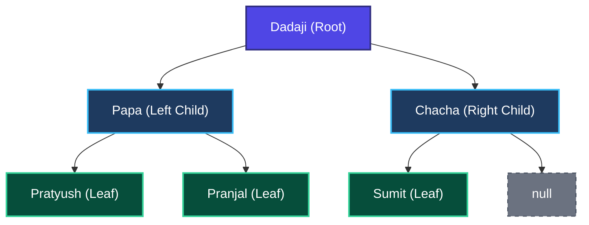
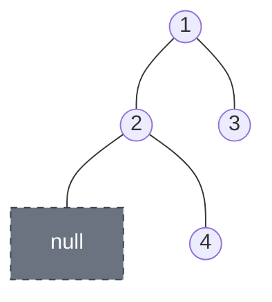

# Trees 02: Tree Traversals — Preorder, Inorder & Postorder

> **DSA Master Revision Notes** for campus placements and technical interviews (TCS NQT Hands-on Coding / Digital / Prime, Infosys DSE/SP, Cognizant, Wipro, Accenture, LeetCode). Based on Episode 02 of the Tree Series by **Padho with Pratyush**. Formatted with GitHub-compatible Markdown, KaTeX mathematics, visual ASCII/Mermaid traces, and production Java implementations.

---

## Table of Contents
1. [Part 1: Core Intuition — The "Dadaji & Chocolate" Family Tree Analogy](#part-1-core-intuition--the-dadaji--chocolate-family-tree-analogy)
   - [1. The Family Tree Setup](#1-the-family-tree-setup)
   - [2. The Unsaid Family Rule (How Inorder Works)](#2-the-unsaid-family-rule-how-inorder-works)
   - [3. Step-by-Step Dry Run of the Chocolate Movement](#3-step-by-step-dry-run-of-the-chocolate-movement)
   - [The Magic Observation](#the-magic-observation)
2. [Part 2: The 3 Traversal Rules (Preorder, Inorder, Postorder)](#part-2-the-3-traversal-rules-preorder-inorder-postorder)
   - [The Master Rule of Traversal Positioning](#the-master-rule-of-traversal-positioning)
   - [Summary Comparison Table](#summary-comparison-table)
3. [Part 3: Recursion Dry Run on a Number Tree (From Lecture)](#part-3-recursion-dry-run-on-a-number-tree-from-lecture)
   - [Number Tree Structure](#number-tree-structure)
   - [Tracing `fun(node)` for Inorder (Left $\to$ Node $\to$ Right)](#tracing-funnode-for-inorder-left-to-node-to-right)
4. [Part 4: Complete Java Implementation (All 3 Traversals)](#part-4-complete-java-implementation-all-3-traversals)
   - [1. Simple Console Print Version (`TreeTraversals.java`)](#1-simple-console-print-version-treetraversalsjava)
   - [2. LeetCode Ready Template (Returning `List<Integer>`)](#2-leetcode-ready-template-returning-listinteger)
   - [Complexity Analysis (Interview Level)](#complexity-analysis-interview-level)
5. [Part 5: Actionable Interview & Career Takeaways](#part-5-actionable-interview--career-takeaways)
   - [Why this matters for your placements](#why-this-matters-for-your-placements)
   - [What you should do](#what-you-should-do)
   - [What you should avoid](#what-you-should-avoid)
   - [Your Next Practical Step](#your-next-practical-step)

---

## Part 1: Core Intuition — The "Dadaji & Chocolate" Family Tree Analogy

### 1. The Family Tree Setup
Imagine a close-knit Indian family tree with 6 members:
- **Root (Top Leader):** Dadaji (Grandfather)
- **Dadaji's 2 Sons:** Papa (Left Child) and Chacha (Right Child)
- **Papa's 2 Children:** Pratyush (Left Child) and Pranjal (Right Child)
- **Chacha's 1 Child:** Sumit (Left Child — Chacha has no right child)



---

### 2. The Unsaid Family Rule (How Inorder Works)
Suppose a big bar of **Chocolate** arrives at the front door. Because Dadaji is the head of the family, he receives the chocolate first.

However, every parent in this house strictly follows **3 disciplined steps** whenever they hold the chocolate:

$$
\Large
\boxed{\begin{aligned}
\textbf{Step 1 (Left):} & \quad \text{Pehle apne Left wale bacche ko khilao} \\
\textbf{Step 2 (Node / Self):} & \quad \text{Jab chocolate wapas aaye, fir khud 1 bite khao} \\
\textbf{Step 3 (Right):} & \quad \text{Last mein Right wale bacche ko khilao}
\end{aligned}}
$$

---

### 3. Step-by-Step Dry Run of the Chocolate Movement
Let's trace how the chocolate moves through the family tree using a structured execution matrix (**Eating = Printing the Node**):

| Step | Person Holding Chocolate | Step 1: Check Left | Step 2: Eat Bite (Print Self) | Step 3: Check Right | Next Action / Handover | Eating Order (Output) |
| :--- | :--- | :--- | :--- | :--- | :--- | :--- |
| **1** | **Dadaji** | Passes to Left (Papa) | Waiting for Left | Pending | Down to **Papa** | — |
| **2** | **Papa** | Passes to Left (Pratyush) | Waiting for Left | Pending | Down to **Pratyush** | — |
| **3** | **Pratyush** | No left child (`null`) | **Eats 1st Bite!** | No right child (`null`) | Done! Returns chocolate to Papa | **Pratyush** |
| **4** | **Papa** | Left finished! | **Eats 2nd Bite!** | Passes to Right (Pranjal) | Down to **Pranjal** | Pratyush $\to$ **Papa** |
| **5** | **Pranjal** | No left child (`null`) | **Eats 3rd Bite!** | No right child (`null`) | Done! Returns chocolate to Papa | Pratyush $\to$ Papa $\to$ **Pranjal** |
| **6** | **Papa** | All 3 steps complete | Already eaten | Already visited | Returns chocolate to Dadaji | Pratyush $\to$ Papa $\to$ Pranjal |
| **7** | **Dadaji** | Left subtree complete! | **Eats 4th Bite!** | Passes to Right (Chacha) | Down to **Chacha** | ... $\to$ **Dadaji** |
| **8** | **Chacha** | Passes to Left (Sumit) | Waiting for Left | Pending | Down to **Sumit** | ... $\to$ Dadaji |
| **9** | **Sumit** | No left child (`null`) | **Eats 5th Bite!** | No right child (`null`) | Done! Returns chocolate to Chacha | ... $\to$ Dadaji $\to$ **Sumit** |
| **10** | **Chacha** | Left finished! | **Eats 6th Bite!** | No right child (`null`) | Done! Returns to Dadaji | ... $\to$ Sumit $\to$ **Chacha** |
| **11** | **Dadaji** | All subtrees complete | Already eaten | Finished | **Traversal Complete!** | **Pratyush $\to$ Papa $\to$ Pranjal $\to$ Dadaji $\to$ Sumit $\to$ Chacha** |

$$
\Large
\boxed{\text{Final Inorder Sequence: } \quad \text{Pratyush} \to \text{Papa} \to \text{Pranjal} \to \text{Dadaji} \to \text{Sumit} \to \text{Chacha}}
$$

### The Magic Observation
> [!TIP]
> Pick **ANY parent** in the tree (e.g., Dadaji or Papa).
> In the output list:
> - Their entire **Left family** appears **BEFORE** them.
> - The **Parent** appears in the **MIDDLE**.
> - Their entire **Right family** appears **AFTER** them!

---

## Part 2: The 3 Traversal Rules (Preorder, Inorder, Postorder)

### The Master Rule of Traversal Positioning
In all three traversals:
$$
\Large
\boxed{\text{Left ALWAYS comes before Right: } \quad \text{Left} \to \text{Right} \quad \text{(This never flips!)}}
$$

The **ONLY** thing that changes is **when the Parent (Node) eats the chocolate / prints its value**:

### Summary Comparison Table

| Traversal Name | Meaning of Prefix | Order of Operations | Family Analogy (When Parent Eats) |
| :--- | :--- | :--- | :--- |
| **1. Preorder** | **Pre** = Pehle (*Before*) | **Node** $\to$ **Left** $\to$ **Right** | Parent eats **first**, then gives to Left child, then Right child. |
| **2. Inorder** | **In** = Beech mein (*Middle*) | **Left** $\to$ **Node** $\to$ **Right** | Parent gives to Left child first, eats in the **middle**, then gives to Right child. |
| **3. Postorder** | **Post** = Baad mein (*After*) | **Left** $\to$ **Right** $\to$ **Node** | Parent gives to Left child, then Right child, and eats at the **very end**. |

---

## Part 3: Recursion Dry Run on a Number Tree (From Lecture)

### Number Tree Structure
Consider this Binary Tree from the lecture (where Node 2 has **NO** left child, only a right child 4):



### Tracing `fun(node)` for Inorder (Left $\to$ Node $\to$ Right)

Here is the exact recursive call stack evolution presented as a clean execution table:

| Step | Function Call | Current Node | Base Case Guard | Phase 1: Explore Left | Phase 2: Visit Self (Print) | Phase 3: Explore Right | Master Inorder Output |
| :--- | :--- | :--- | :--- | :--- | :--- | :--- | :--- |
| **1** | `fun(1)` | `1` | `1 != null` | Calls `fun(2)` | Waiting for Left | Pending | `—` |
| **2** | `fun(2)` | `2` | `2 != null` | Calls `fun(null)` | Waiting for Left | Pending | `—` |
| **3** | `fun(null)` | `null` | **Hits Base Case!** | Returns immediately | — | — | `—` |
| **4** | `fun(2)` | `2` | Resumes after Left | Done | **Prints 2** | Calls `fun(4)` | **`2`** |
| **5** | `fun(4)` | `4` | `4 != null` | Calls `fun(null)` $\implies$ returns | **Prints 4** | Calls `fun(null)` $\implies$ returns | **`2 4`** |
| **6** | `fun(2)` | `2` | Right done | Done | Done | Returns to `fun(1)` | `2 4` |
| **7** | `fun(1)` | `1` | Left side complete! | Done | **Prints 1** | Calls `fun(3)` | **`2 4 1`** |
| **8** | `fun(3)` | `3` | `3 != null` | Calls `fun(null)` $\implies$ returns | **Prints 3** | Calls `fun(null)` $\implies$ returns | **`2 4 1 3`** |
| **9** | `fun(1)` | `1` | All subtrees resolved | Done | Done | **Complete!** | **`2 4 1 3`** |

$$
\Large
\boxed{\text{Final Inorder Output: } \quad 2 \quad 4 \quad 1 \quad 3}
$$

---

## Part 4: Complete Java Implementation (All 3 Traversals)

Notice how changing the position of a **single line of code** (`System.out.print` or `list.add`) converts the logic between Inorder, Preorder, and Postorder!

### 1. Simple Console Print Version (`TreeTraversals.java`)

```java
class TreeNode {
    int data;
    TreeNode left, right;

    TreeNode(int data) {
        this.data = data;
        this.left = null;
        this.right = null;
    }
}

public class TreeTraversals {

    // 1. INORDER TRAVERSAL (Left -> Node -> Right)
    public static void inorder(TreeNode node) {
        if (node == null) {
            return; // Base Case: Empty branch / leaf child reached
        }
        inorder(node.left);                  // Step 1: Pehle Left bacche ko mauka do
        System.out.print(node.data + " ");   // Step 2: Khud khao (Print Self in Middle)
        inorder(node.right);                 // Step 3: Fir Right bacche ko mauka do
    }

    // 2. PREORDER TRAVERSAL (Node -> Left -> Right)
    public static void preorder(TreeNode node) {
        if (node == null) {
            return;
        }
        System.out.print(node.data + " ");   // Step 1: Pehle khud khao (Print Self FIRST)
        preorder(node.left);                 // Step 2: Fir Left bacche ko mauka do
        preorder(node.right);                // Step 3: Fir Right bacche ko mauka do
    }

    // 3. POSTORDER TRAVERSAL (Left -> Right -> Node)
    public static void postorder(TreeNode node) {
        if (node == null) {
            return;
        }
        postorder(node.left);                // Step 1: Pehle Left bacche ko mauka do
        postorder(node.right);               // Step 2: Fir Right bacche ko mauka do
        System.out.print(node.data + " ");   // Step 3: Sabse last mein khud khao (Print Self LAST)
    }

    public static void main(String[] args) {
        // Building the exact lecture tree: 1 -> (left: 2, right: 3), 2 -> (right: 4)
        TreeNode root = new TreeNode(1);
        root.left = new TreeNode(2);
        root.right = new TreeNode(3);
        root.left.right = new TreeNode(4);

        System.out.print("Inorder (L-N-R):   ");
        inorder(root);   // Output: 2 4 1 3
        System.out.println();

        System.out.print("Preorder (N-L-R):  ");
        preorder(root);  // Output: 1 2 4 3
        System.out.println();

        System.out.print("Postorder (L-R-N): ");
        postorder(root); // Output: 4 2 3 1
        System.out.println();
    }
}
```

---

### 2. LeetCode Ready Template (Returning `List<Integer>`)
On LeetCode (**LC 94:** Binary Tree Inorder, **LC 144:** Preorder, **LC 145:** Postorder), you must return a `List<Integer>` instead of printing to the console:

```java
import java.util.ArrayList;
import java.util.List;

class Solution {
    private void fun(TreeNode node, List<Integer> result) {
        if (node == null) {
            return;
        }
        // For Inorder: Left -> Node -> Right
        fun(node.left, result);
        result.add(node.val); // Swap this line up for Preorder, or down for Postorder!
        fun(node.right, result);
    }

    public List<Integer> inorderTraversal(TreeNode root) {
        List<Integer> result = new ArrayList<>();
        fun(root, result);
        return result;
    }
}
```

---

### Complexity Analysis (Interview Level)
- **Time Complexity:** $\mathcal{O}(N)$ — Every single node in the tree gets the chocolate and executes the function exactly once (plus at most $2N$ null checks).
- **Space Complexity:** $\mathcal{O}(H)$ — Where $H$ is the Height of the Tree (due to internal recursion call stack frames).
  - In the worst case (a **skewed tree** looking like a Linked List): $\mathcal{O}(N)$.
  - In the best case (a **balanced tree**): $\mathcal{O}(\log N)$.

---

## Part 5: Actionable Interview & Career Takeaways

### Why this matters for your placements:
Nearly **80% of all Binary Tree problems are just Preorder, Inorder, or Postorder traversals in disguise!**
Instead of `System.out.print(node.data)`, you will simply replace that 1 line with:
- `sum += node.data` (Sum of Nodes)
- `count++` (Count Nodes)
- `max = Math.max(max, node.data)` (Find Max)
- `1 + Math.max(leftHeight, rightHeight)` (Height Calculation)

### What you should do:
Memorize the position of the **Node**:
- **Pre** = Node 1st (`Node, Left, Right`)
- **In** = Node 2nd (`Left, Node, Right`)
- **Post** = Node 3rd (`Left, Right, Node`)

### What you should avoid:
- **Never try to mentally trace an entire 15-node tree at once in an interview.**
- That causes mental block. Always **trust recursion** for `node.left` and `node.right`, and focus strictly on what the current circle (node) needs to do!

### Your Next Practical Step:
Open LeetCode right now and submit:
1. **LeetCode 94 (Binary Tree Inorder Traversal)**
2. **LeetCode 144 (Binary Tree Preorder Traversal)**
3. **LeetCode 145 (Binary Tree Postorder Traversal)**

Submitting them back-to-back in Java will take you less than 5 minutes and add 3 verified solved problems to your profile!
