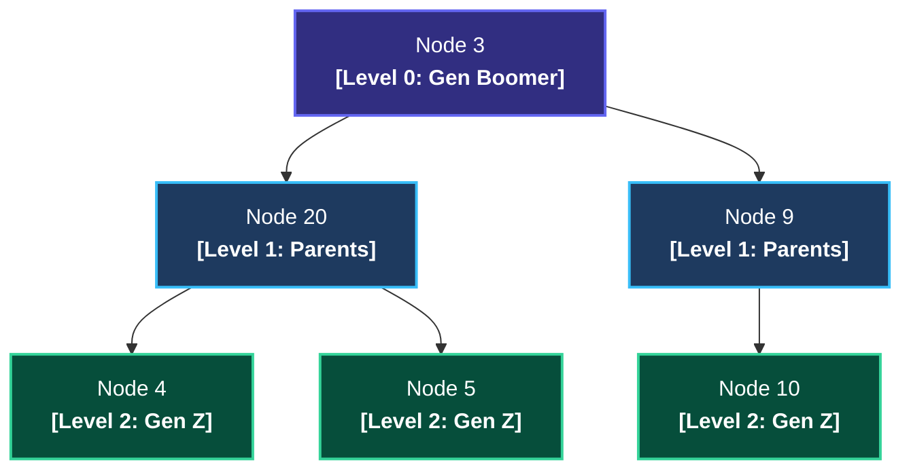
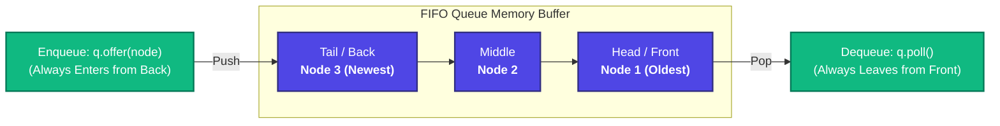
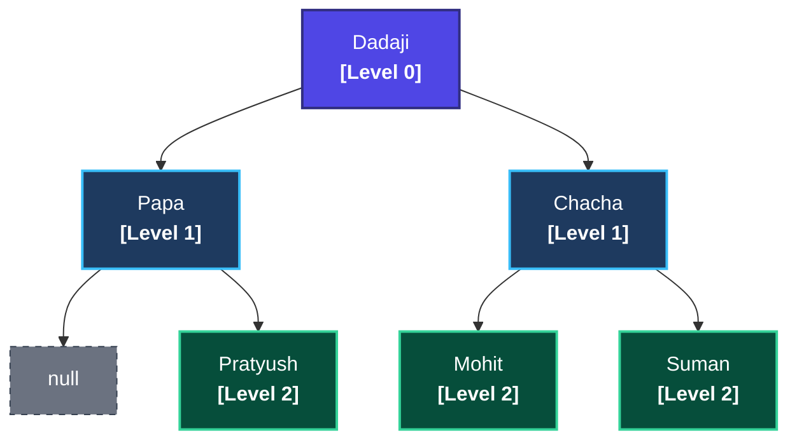
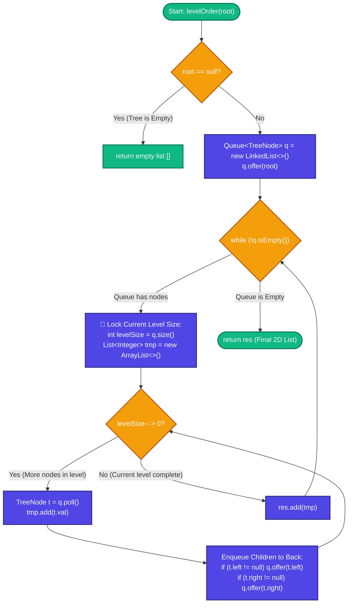

# Trees 03: Level Order Traversal (BFS Intuition & Template)

> **DSA Master Revision Notes** for campus placements and technical interviews (TCS NQT Hands-on Coding / Digital / Prime, Infosys DSE/SP, Cognizant, Wipro, Accenture, LeetCode). Based on Episode 03 of the Tree Series by **Padho with Pratyush**. Formatted with GitHub-compatible Markdown, KaTeX mathematics, visual flowcharts, execution trace tables, and production Java implementations.

---

## Table of Contents
1. [Part 1: Core Intuition — What is Level Order & What is a Queue?](#part-1-core-intuition--what-is-level-order--what-is-a-queue)
   - [1. What is Level Order Traversal? (Horizontal Generations Analogy)](#1-what-is-level-order-traversal-horizontal-generations-analogy)
   - [2. Why Recursion Fails Here & Why We Need a Queue (FIFO)](#2-why-recursion-fails-here--why-we-need-a-queue-fifo)
   - [Stack vs. Queue Comparison Matrix](#stack-vs-queue-comparison-matrix)
   - [FIFO Queue Memory Pipeline](#fifo-queue-memory-pipeline)
   - [C++ Queue vs. Java Queue Syntax Cheat Sheet](#c-queue-vs-java-queue-syntax-cheat-sheet)
2. [Part 2: Problem 1 — Level Order Traversal (LeetCode 102)](#part-2-problem-1--level-order-traversal-leetcode-102)
   - [1. The Lecture's Family Tree Example](#1-the-lectures-family-tree-example)
   - [2. The Master Algorithm Flowchart](#2-the-master-algorithm-flowchart)
   - [3. The 5-Step Execution Blueprint](#3-the-5-step-execution-blueprint)
   - [4. Complete Step-by-Step Execution Trace Table](#4-complete-step-by-step-execution-trace-table)
   - [5. Java Implementation — Level Order Traversal (LeetCode 102)](#5-java-implementation--level-order-traversal-leetcode-102)
   - [Complexity Analysis (Interview Level)](#complexity-analysis-interview-level)
3. [Part 3: Problem 2 — Binary Tree Zigzag Level Order Traversal (LeetCode 103)](#part-3-problem-2--binary-tree-zigzag-level-order-traversal-leetcode-103)
   - [1. Intuition & Alternating Direction Trajectory](#1-intuition--alternating-direction-trajectory)
   - [2. The Lecture's Smart In-Place Array Trick](#2-the-lectures-smart-in-place-array-trick)
   - [3. Zigzag State Evolution Table](#3-zigzag-state-evolution-table)
   - [4. Java Implementation — Zigzag Level Order Traversal (LeetCode 103)](#4-java-implementation--zigzag-level-order-traversal-leetcode-103)
   - [Complexity Analysis](#complexity-analysis)
4. [Part 4: Bonus — How to Solve "Level Order Traversal II" (LeetCode 107)](#part-4-bonus--how-to-solve-level-order-traversal-ii-leetcode-107)
   - [1-Line Fix in Java](#1-line-fix-in-java)
5. [Part 5: Actionable Interview & Career Takeaways](#part-5-actionable-interview--career-takeaways)
   - [Why this template is gold for placements](#why-this-template-is-gold-for-placements)
   - [What you should do](#what-you-should-do)
   - [What you should avoid](#what-you-should-avoid)
   - [Your Next Practical Step](#your-next-practical-step)

---

## Part 1: Core Intuition — What is Level Order & What is a Queue?

### 1. What is Level Order Traversal? (Horizontal Generations Analogy)
In the previous lecture (Preorder, Inorder, Postorder), our traversals were **Depth-First (DFS)** — we plunged straight down one branch before returning to the parent. 

**Level Order Traversal (Breadth-First Search / BFS)** takes the opposite approach: we slice the tree with horizontal lines and visit every node floor-by-floor (**Generation by Generation**) strictly from **Left to Right**.



#### Generational Slicing Matrix

| Tree Floor / Level | Real-World Generation | Nodes Visited (Left $\to$ Right) | Generation Sublist | Master Output List (`res`) |
| :---: | :--- | :--- | :---: | :--- |
| **Level 0** | **Grandparent (Boomer)** | Visit `3` | `[3]` | `[[3]]` |
| **Level 1** | **Parents** | Visit `20` $\implies$ Visit `9` | `[20, 9]` | `[[3], [20, 9]]` |
| **Level 2** | **Children (Gen Z)** | Visit `4` $\implies$ Visit `5` $\implies$ Visit `10` | `[4, 5, 10]` | `[[3], [20, 9], [4, 5, 10]]` |

$$
\Large
\boxed{\text{Final Output (2D List): } \quad [[3], \ [20, 9], \ [4, 5, 10]]}
$$

---

### 2. Why Recursion Fails Here & Why We Need a Queue (FIFO)

> [!WARNING] The Depth Trap: Why Standard Recursion Fails for Level Order
> In standard recursion, calling `traverse(node.left)` immediately forces the CPU to dive down to the bottom-most leaf before `traverse(node.right)` ever runs. 
> Recursion cannot easily jump horizontally across different branches (e.g. from Papa's kids to Chacha's kids). To visit nodes horizontally generation by generation, you **must use an explicit Queue**.

#### Stack vs. Queue Comparison Matrix

| Dimension | Stack (DFS Traversals) | Queue (BFS / Level Order) |
| :--- | :--- | :--- |
| **Operating Discipline** | **FILO / LIFO** (*First In, Last Out*) | **FIFO** (*First In, First Out*) |
| **Real-Life Mental Model** | Vertical pile of cafeteria plates | **Cinema Hall ticket counter line (*Kataar*)** |
| **Data Inflow & Outflow** | Push & Pop happen at the **same top end** | Enters from **Back (Tail)**, exits from **Front (Head)** |
| **Traversal Trajectory** | Plunges vertically down branches | Sweeps horizontally floor-by-floor |
| **Exit Order for `[1, 2, 3]`** | Reversed: `3, 2, 1` | **Preserved:** `1, 2, 3` |
| **Primary Tree Algorithms** | Preorder, Inorder, Postorder, DFS Path Sum | Level Order, Zigzag, Left/Right Views, Shortest Path |

---

### FIFO Queue Memory Pipeline

In a FIFO Queue, elements enter from the **Back** via `offer()` and depart from the **Front** via `poll()`. The exact order in which nodes are discovered is preserved:



---

### C++ Queue vs. Java Queue Syntax Cheat Sheet

| Operation | C++ Standard Template Library | Java Collections Framework (`Queue<TreeNode> q = new LinkedList<>();`) |
| :--- | :--- | :--- |
| **Insert at Back** | `q.push(node)` | `q.offer(node)` *(preferred)* or `q.add(node)` |
| **Inspect Front Element** | `q.front()` | `q.peek()` |
| **Remove from Front** | `q.pop()` | `q.poll()` *(Returns AND removes the front node in 1 atomic step!)* |
| **Check if Empty** | `!q.empty()` | `!q.isEmpty()` |
| **Count of Elements** | `q.size()` | `q.size()` |

---

## Part 2: Problem 1 — Level Order Traversal (LeetCode 102)

### 1. The Lecture's Family Tree Example
Consider the exact family hierarchy traced in the lecture:
- **Level 0 (Grandparent):** Dadaji (Root)
- **Level 1 (Parents):** Papa (Left Child) and Chacha (Right Child)
- **Level 2 (Children):** 
  - Papa has **no left child** (`null`), and **1 right child** (`Pratyush`).
  - Chacha has **2 children**: `Mohit` (Left) and `Suman` (Right).



---

### 2. The Master Algorithm Flowchart



---

### 3. The 5-Step Execution Blueprint

| Step | Phase Name | Execution Rule | Java Code Line |
| :---: | :--- | :--- | :--- |
| **Step 1** | **Base Case Guard** | If the tree root is `null`, return an empty list immediately. | `if (root == null) return res;` |
| **Step 2** | **Queue Bootstrap** | Instantiate the Queue and enqueue the `root` node. | `Queue<TreeNode> q = new LinkedList<>(); q.offer(root);` |
| **Step 3** | **Generation Size Snapshot** | Lock `q.size()` *before* enqueuing any new children. | `int levelSize = q.size(); List<Integer> tmp = new ArrayList<>();` |
| **Step 4** | **Horizontal Node Drain** | Dequeue `levelSize` nodes, add value to `tmp`, push children to Queue. | `TreeNode t = q.poll(); tmp.add(t.val); ...` |
| **Step 5** | **Commit to Output** | Append the completed `tmp` list into the master `res` list. | `res.add(tmp);` |

#### Detailed Step-by-Step Breakdown:

#### Step 1: Base Case Guard
> **Why it matters:** Passing a `null` root into the queue would trigger `NullPointerException` later. Returning `res` immediately keeps the code safe and clean.
```java
if (root == null) return res;
```

#### Step 2: Queue Bootstrap
> **Why it matters:** Dadaji (Root) is the head of the hierarchy. Placing him in the queue triggers the BFS chain reaction.
```java
Queue<TreeNode> q = new LinkedList<>();
q.offer(root);
```

#### Step 3: The `q.size()` Snapshot Trick (Crucial Invariant!)
> **Why it matters:** The Queue will soon hold nodes from *different* generations simultaneously! Locking `int levelSize = q.size()` captures exactly how many nodes belong to the **current** floor before any of their children are pushed.
```java
int levelSize = q.size();
List<Integer> tmp = new ArrayList<>();
```

#### Step 4: Horizontal Node Drain
> **Why it matters:** By looping exactly `levelSize` times, we consume only the current generation's nodes. Any new children enqueued during this loop will safely wait for the next generation's turn.
```java
while (levelSize-- > 0) {
    TreeNode t = q.poll();
    tmp.add(t.val);
    if (t.left != null)  q.offer(t.left);
    if (t.right != null) q.offer(t.right);
}
```

#### Step 5: Commit Sublist to Master Result
> **Why it matters:** Once the inner loop completes, all nodes on this horizontal plane have been recorded in `tmp`. We append `tmp` to `res` and let the outer `while (!q.isEmpty())` repeat for the next level.
```java
res.add(tmp);
```

---

### 4. Complete Step-by-Step Execution Trace Table

Let's trace how the Queue state evolves cycle-by-cycle for the lecture's tree:

| Cycle / Phase | Node Popped (`t`) | Action Taken | Children Enqueued | Queue State (`q`) | Level Sublist (`tmp`) | Master Result (`res`) |
| :--- | :---: | :--- | :--- | :--- | :--- | :--- |
| **Bootstrap** | — | Enqueue Root (Dadaji) | — | `[Dadaji]` | `[]` | `[]` |
| **Cycle 1 (L0)** | `Dadaji` | Add to `tmp`, check children | `Papa`, `Chacha` | `[Papa, Chacha]` | `[Dadaji]` | `[]` |
| **Cycle 1 Commit** | — | Level 0 Complete | — | `[Papa, Chacha]` | `[Dadaji]` | `[[Dadaji]]` |
| **Cycle 2 (L1, Run 1)**| `Papa` | Add to `tmp`, left is null | `Pratyush` | `[Chacha, Pratyush]` | `[Papa]` | `[[Dadaji]]` |
| **Cycle 2 (L1, Run 2)**| `Chacha` | Add to `tmp`, check children | `Mohit`, `Suman` | `[Pratyush, Mohit, Suman]` | `[Papa, Chacha]` | `[[Dadaji]]` |
| **Cycle 2 Commit** | — | Level 1 Complete | — | `[Pratyush, Mohit, Suman]` | `[Papa, Chacha]` | `[[Dadaji], [Papa, Chacha]]` |
| **Cycle 3 (L2, Run 1)**| `Pratyush`| Add to `tmp`, leaves null | None | `[Mohit, Suman]` | `[Pratyush]` | `[[Dadaji], [Papa, Chacha]]` |
| **Cycle 3 (L2, Run 2)**| `Mohit` | Add to `tmp`, leaves null | None | `[Suman]` | `[Pratyush, Mohit]` | `[[Dadaji], [Papa, Chacha]]` |
| **Cycle 3 (L2, Run 3)**| `Suman` | Add to `tmp`, leaves null | None | `[]` *(Empty!)* | `[Pratyush, Mohit, Suman]` | `[[Dadaji], [Papa, Chacha]]` |
| **Cycle 3 Commit** | — | Level 2 Complete | — | `[]` | `[Pratyush, Mohit, Suman]` | `[[Dadaji], [Papa, Chacha], [Pratyush, Mohit, Suman]]` |
| **Termination** | — | Queue empty: loop exits | — | `[]` | — | **Final 2D List Returned** |

---

### 5. Java Implementation — Level Order Traversal (LeetCode 102)

```java
import java.util.*;

class TreeNode {
    int val;
    TreeNode left;
    TreeNode right;
    TreeNode(int val) { this.val = val; }
}

public class Solution {
    public List<List<Integer>> levelOrder(TreeNode root) {
        List<List<Integer>> res = new ArrayList<>();
        
        // Step 1: Base Case Guard
        if (root == null) {
            return res;
        }

        // Step 2: Queue Bootstrap
        Queue<TreeNode> q = new LinkedList<>();
        q.offer(root);

        // Step 3: Traverse level by level
        while (!q.isEmpty()) {
            int levelSize = q.size(); // Snapshot count of nodes at current level
            List<Integer> tmp = new ArrayList<>();

            // Step 4: Drain all nodes belonging exclusively to this level
            while (levelSize-- > 0) {
                TreeNode t = q.poll(); // Pops front node in O(1)
                tmp.add(t.val);

                // Enqueue left and right children to back of queue
                if (t.left != null) {
                    q.offer(t.left);
                }
                if (t.right != null) {
                    q.offer(t.right);
                }
            }

            // Step 5: Commit completed generation sublist to master result
            res.add(tmp);
        }

        return res;
    }
}
```

### Complexity Analysis (Interview Level)
- **Time Complexity:** $\mathcal{O}(N)$ — Every single node in the tree is enqueued (`offer`) and dequeued (`poll`) exactly once.
- **Space Complexity:** $\mathcal{O}(N)$ — The queue holds at most the maximum width of the tree. For a full binary tree, the last level contains $\lceil N/2 \rceil$ leaf nodes, which requires $\mathcal{O}(N)$ auxiliary memory.

---

## Part 3: Problem 2 — Binary Tree Zigzag Level Order Traversal (LeetCode 103)

### 1. Intuition & Alternating Direction Trajectory
In **Zigzag Traversal**, nodes are read in alternating directions for consecutive levels:
- **Level 0 (Even):** Left $\to$ Right $\implies$ `[Dadaji]`
- **Level 1 (Odd):** Right $\to$ Left (*Ulta*) $\implies$ `[Chacha, Papa]`
- **Level 2 (Even):** Left $\to$ Right $\implies$ `[Pratyush, Mohit, Suman]`

---

### 2. The Lecture's Smart In-Place Array Trick

> [!IMPORTANT] Never Reverse Queue Enqueue Order!
> A common beginner mistake is trying to push right children before left children into the queue on odd levels. **Never do this!** Reversing enqueue order corrupts the child-order for all future downstream generations.
> 
> **The Golden Rule:** Always keep queue operations strictly normal (`left`, then `right`). Instead, alter only **where you place each node's value inside a pre-allocated array of size `levelSize`**!

```java
// Two-pointer insertion indices:
int first = 0;             // Points to front of tmp array
int last = levelSize - 1;  // Points to tail of tmp array

// If Left-to-Right (Normal):
tmp[first++] = t.val;

// If Right-to-Left (Reversed):
tmp[last--] = t.val;
```

---

### 3. Zigzag State Evolution Table

Notice how Level 1 (`Papa` and `Chacha`) gets reversed in $\mathcal{O}(1)$ without expensive `Collections.reverse()` operations:

| Step | Node Popped | Direction (`leftToRight`) | Target Array Slot | `tmp` Array State | Active Pointers |
| :--- | :---: | :---: | :--- | :--- | :--- |
| **Start L1** | — | `0` (Right to Left) | — | `[ null, null ]` | `first = 0, last = 1` |
| **Run 1** | `Papa` | `0` | `tmp[last]` $\implies$ `tmp[1]` | `[ null, Papa ]` | `first = 0, last = 0` |
| **Run 2** | `Chacha` | `0` | `tmp[last]` $\implies$ `tmp[0]` | `[ Chacha, Papa ]` | `first = 0, last = -1` |

$$
\Large
\boxed{\text{Output for Level 1: } \quad [\text{Chacha}, \ \text{Papa}] \quad (\mathcal{O}(1) \text{ In-Place Reversal})}
$$

---

### 4. Java Implementation — Zigzag Level Order Traversal (LeetCode 103)

```java
import java.util.*;

public class Solution {
    public List<List<Integer>> zigzagLevelOrder(TreeNode root) {
        List<List<Integer>> res = new ArrayList<>();
        if (root == null) {
            return res;
        }

        Queue<TreeNode> q = new LinkedList<>();
        q.offer(root);

        // Direction flag: 1 means Left-to-Right, 0 means Right-to-Left
        int leftToRight = 1; 

        while (!q.isEmpty()) {
            int levelSize = q.size();
            
            // Pre-allocate fixed array of size levelSize
            Integer[] tmp = new Integer[levelSize];
            int first = 0;
            int last = levelSize - 1;

            while (levelSize-- > 0) {
                TreeNode t = q.poll();

                // Fill from front or back based on direction flag
                if (leftToRight == 1) {
                    tmp[first++] = t.val; // Normal Left to Right
                } else {
                    tmp[last--] = t.val;  // Reverse Right to Left
                }

                // Queue insertion discipline NEVER changes!
                if (t.left != null) {
                    q.offer(t.left);
                }
                if (t.right != null) {
                    q.offer(t.right);
                }
            }

            // Convert array to List and commit
            res.add(Arrays.asList(tmp));

            // Flip direction flag for next generation: (1 -> 0, 0 -> 1)
            leftToRight = 1 - leftToRight;
        }

        return res;
    }
}
```

### Complexity Analysis
- **Time Complexity:** $\mathcal{O}(N)$ — Direct index writes inside the pre-allocated array cost $\mathcal{O}(1)$.
- **Space Complexity:** $\mathcal{O}(N)$ — Auxiliary space for the BFS queue and the output structure.

---

## Part 4: Bonus — How to Solve "Level Order Traversal II" (LeetCode 107)

In **LeetCode 107 (Binary Tree Level Order Traversal II)**, the problem asks for the levels from **Bottom-to-Top**:
$$
[[Pratyush, Mohit, Suman], \ [Papa, Chacha], \ [Dadaji]]
$$

### 1-Line Fix in Java:
Execute the standard Level Order code from Problem 1, and immediately before returning `res`, reverse the outer list:

```java
Collections.reverse(res);
return res;
```

---

## Part 5: Actionable Interview & Career Takeaways

### Why this template is gold for placements:
This single `while (!q.isEmpty())` + `int levelSize = q.size()` template solves **over 15+ LeetCode problems** with minimal adjustments:
1. **Right View / Left View of Binary Tree (LC 199):** Record only `i == levelSize - 1` (Right View) or `i == 0` (Left View) during the inner loop!
2. **Average of Levels in Binary Tree (LC 637):** Sum all elements in `tmp` and divide by `levelSize`.
3. **Maximum Level Sum (LC 1161):** Track which level produces the greatest cumulative sum.
4. **Minimum Depth of Binary Tree (LC 111):** The very first time you dequeue a node with `t.left == null && t.right == null`, return the current level count!
5. **Graph BFS (Rotting Oranges, Shortest Path):** Uses the exact same snapshot queue expansion.

### What you should do:
- Practice typing the **Queue Bootstrap + `levelSize` snapshot** template from memory until you can write it in under 60 seconds.

### What you should avoid:
- **Never alter `q.offer(t.left)` and `q.offer(t.right)` order for Zigzag traversal.** Keep the queue orderly, and adjust the target array index instead.

### Your Next Practical Step:
Open LeetCode and solve these 3 problems back-to-back:
1. **LeetCode 102:** Binary Tree Level Order Traversal
2. **LeetCode 103:** Binary Tree Zigzag Level Order Traversal
3. **LeetCode 107:** Binary Tree Level Order Traversal II
