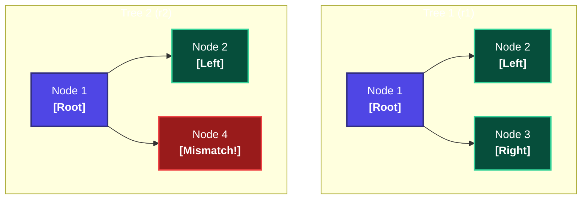
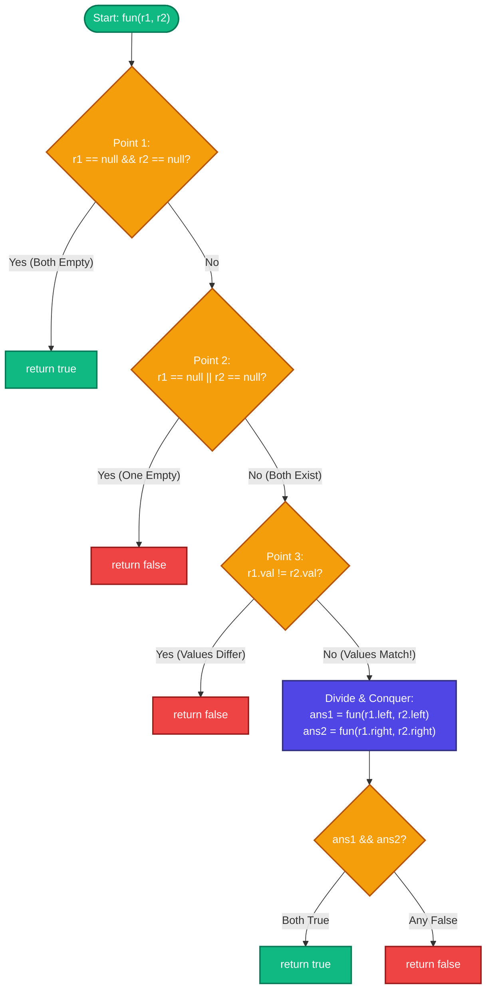
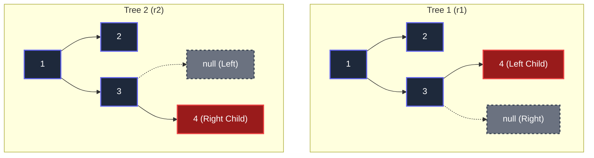
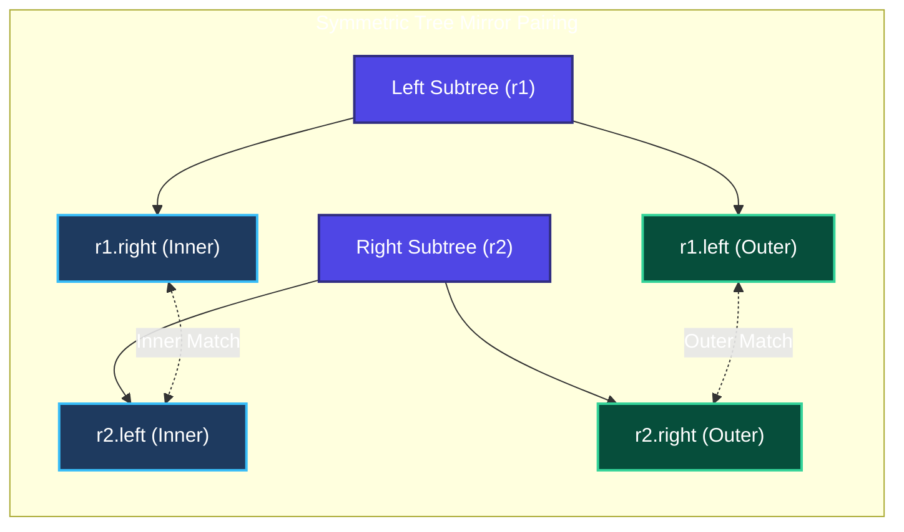

# Trees 04: Tree Symmetry Pattern — One Pattern To Solve Any Tree Question

> **DSA Master Revision Notes** for campus placements and technical interviews (TCS NQT Hands-on Coding / Digital / Prime, Infosys DSE/SP, Cognizant, Wipro, Accenture, LeetCode). Based on Episode 04 of the Tree Series by **Padho with Pratyush**. Formatted with GitHub-compatible Markdown, KaTeX mathematics, visual flowcharts, execution trace tables, and production Java implementations.

---

## Table of Contents
1. [Part 1: Core Intuition — How to Identify & Think About This Pattern](#part-1-core-intuition--how-to-identify--think-about-this-pattern)
   - [1. How to Identify the "Mirror & Symmetry" Pattern](#1-how-to-identify-the-mirror--symmetry-pattern)
   - [2. The Golden Rule of Thinking: "Always Imagine a 3-Node Tree"](#2-the-golden-rule-of-thinking-always-imagine-a-3-node-tree)
2. [Part 2: The 5-Point Master Template (Same Tree — LeetCode 100)](#part-2-the-5-point-master-template-same-tree--leetcode-100)
   - [The 5-Point Universal Decision Matrix](#the-5-point-universal-decision-matrix)
   - [Master Algorithm Flowchart](#master-algorithm-flowchart)
   - [The 5-Step Execution Blueprint](#the-5-step-execution-blueprint)
3. [Part 3: Complete Recursive Dry Run (From Lecture)](#part-3-complete-recursive-dry-run-from-lecture)
   - [The Lecture's Tricky Structural Mismatch Example](#the-lectures-tricky-structural-mismatch-example)
   - [Complete Call Stack Trace Table](#complete-call-stack-trace-table)
4. [Part 4: Complete Java Implementation](#part-4-complete-java-implementation)
   - [1. Same Tree (LeetCode 100 — Production Java Solution)](#1-same-tree-leetcode-100--production-java-solution)
   - [Complexity Analysis (Interview Level)](#complexity-analysis-interview-level)
   - [2. Bonus Homework Solution: Symmetric Tree (LeetCode 101)](#2-bonus-homework-solution-symmetric-tree-leetcode-101)
   - [The Mirror Twist (Outer Pairs & Inner Pairs)](#the-mirror-twist-outer-pairs--inner-pairs)
   - [Java Implementation — Symmetric Tree (LeetCode 101)](#java-implementation--symmetric-tree-leetcode-101)
5. [Part 5: Actionable Placement & Career Takeaways](#part-5-actionable-placement--career-takeaways)
   - [Why this template is a placement superpower](#why-this-template-is-a-placement-superpower)
   - [What you should do: The Strict Check Ordering](#what-you-should-do-the-strict-check-ordering)
   - [What you should avoid: The NullPointerException Trap](#what-you-should-avoid-the-nullpointerexception-trap)
   - [Your Next Practical Step](#your-next-practical-step)

---

## Part 1: Core Intuition — How to Identify & Think About This Pattern

### 1. How to Identify the "Mirror & Symmetry" Pattern

Whenever an interview question asks you to compare **two trees** (or **two symmetric halves** of one tree) and return a boolean (`true` / `false`) based on structural equivalence or reflection, you are dealing with the **Dual-Tree Symmetry Pattern**:

| Target Problem | Core Interview Question | Comparison Target | LeetCode ID |
| :--- | :--- | :--- | :---: |
| **Same Tree** | Are both trees 100% identical in structure and data? | Tree 1 (`r1`) vs. Tree 2 (`r2`) | **LC 100** |
| **Symmetric Tree** | Is the tree a mirror image of itself around the center? | Left Subtree (`root.left`) vs. Right Subtree (`root.right`) | **LC 101** |
| **Subtree of Another Tree** | Does a tree contain an identical copy of another tree? | Current Subtree (`root`) vs. Target Subtree (`subRoot`) | **LC 572** |
| **Flip Equivalent Trees** | Can trees become identical by flipping subtrees? | Flipped pairs (`r1.left` vs `r2.right` OR `r2.left`) | **LC 951** |

---

### 2. The Golden Rule of Thinking: "Always Imagine a 3-Node Tree"

> [!TIP] The 3-Node Mental Model
> **Never start by drawing a giant 15-node tree in an interview** — your brain will get overwhelmed by recursive branches.
> 
> Always draw a **minimal 3-node tree** (1 Root, 1 Left Child, 1 Right Child). Formulate the rules for comparing just the top roots (`r1` and `r2`) first, and let recursion handle the children!



---

## Part 2: The 5-Point Master Template (Same Tree — LeetCode 100)

Suppose you are given two roots: `r1` and `r2`. You want to check if both trees are 100% identical in structure (*aakar-prakar*) and node values.

### The 5-Point Universal Decision Matrix

$$
\Large
\boxed{\text{Identity Invariant: } \quad (\text{Self Match}) \ \land \ (\text{Left Subtree Match}) \ \land \ (\text{Right Subtree Match})}
$$

| Phase | Evaluation Check | Java Condition | Return Value | Rationale & Safety Invariant |
| :---: | :--- | :--- | :---: | :--- |
| **Point 1** | **Both are null** | `r1 == null && r2 == null` | `true` | Both branches terminate together $\implies$ identical empty leaves! |
| **Point 2** | **Only ONE is null** | `r1 == null \|\| r2 == null` | `false` | Asymmetry! One tree has a node, the other has `null`. *(Safe because Point 1 passed)* |
| **Point 3** | **Values don't match** | `r1.val != r2.val` | `false` | Both circles exist, but values mismatch (e.g. `3 != 4`). Immediate mismatch! |
| **Point 4** | **Recurse Left Subtrees** | `fun(r1.left, r2.left)` | `boolean` | Repeat the exact same 5 points on both Left children. |
| **Point 5** | **Recurse Right Subtrees** | `fun(r1.right, r2.right)` | `boolean` | Repeat the exact same 5 points on both Right children. |

> [!NOTE] The Short-Circuit Coding Trick
> Notice why `if (r1 == null || r2 == null)` in **Point 2** is completely safe:
> Because **Point 1** already returned if *both* are null, reaching Point 2 guarantees that **exactly one** of them is null and the other is non-null!

---

### Master Algorithm Flowchart



---

### The 5-Step Execution Blueprint

| Step | Phase Name | Execution Rule | Java Code Line |
| :---: | :--- | :--- | :--- |
| **Step 1** | **Both Null Guard** | If both nodes are null, both subtrees are empty and identical. | `if (r1 == null && r2 == null) return true;` |
| **Step 2** | **Single Null Guard** | If exactly one node is null, structure is asymmetric. | `if (r1 == null \|\| r2 == null) return false;` |
| **Step 3** | **Value Mismatch Guard** | Both exist; if data differs, subtrees are not identical. | `if (r1.val != r2.val) return false;` |
| **Step 4** | **Subtree Recurse** | Check if left subtrees match AND right subtrees match. | `boolean ans1 = fun(r1.left, r2.left); ...` |
| **Step 5** | **Conjunctive Return** | Both left and right subtrees must be identical. | `return ans1 && ans2;` |

#### Detailed Step-by-Step Breakdown:

#### Step 1: Point 1 (Both Null Guard)
> **Why it matters:** When recursion reaches past leaf nodes (`null`), both trees terminating at the exact same depth confirms structural equivalence.
```java
if (r1 == null && r2 == null) return true;
```

#### Step 2: Point 2 (Single Null Guard)
> **Why it matters:** If one tree terminates while the other tree has more nodes, they have different shapes. Returning `false` immediately cuts off unnecessary recursion.
```java
if (r1 == null || r2 == null) return false;
```

#### Step 3: Point 3 (Value Mismatch Guard)
> **Why it matters:** Because Points 1 and 2 already guarded against nulls, dereferencing `r1.val` and `r2.val` is 100% safe from `NullPointerException`.
```java
if (r1.val != r2.val) return false;
```

#### Step 4: Points 4 & 5 (Recursive Divide-and-Conquer)
> **Why it matters:** Passing roots `1 == 1` does not mean the entire tree matches! We must verify both child branches independently.
```java
boolean ans1 = fun(r1.left, r2.left);
boolean ans2 = fun(r1.right, r2.right);
```

#### Step 5: Conjunctive Verdict
> **Why it matters:** The trees are identical if and only if **both** the left branch AND the right branch report `true`.
```java
return ans1 && ans2;
```

---

## Part 3: Complete Recursive Dry Run (From Lecture)

### The Lecture's Tricky Structural Mismatch Example

Consider the exact edge case traced in the lecture: both trees contain values `{1, 2, 3, 4}`. However, in **Tree 1**, node `4` is the **left child** of `3`, whereas in **Tree 2**, node `4` is the **right child** of `3`:



---

### Complete Call Stack Trace Table

| Call # | Function Call | Current Nodes (`r1`, `r2`) | Point 1 Check | Point 2 Check | Point 3 Check | Recursive Action | Result Returned |
| :---: | :--- | :--- | :---: | :---: | :---: | :--- | :---: |
| **1** | `fun(1, 1)` | Roots `(1, 1)` | No | No | `1 == 1` (Pass) | Invokes Point 4 on Left children $\implies$ `fun(2, 2)` | Pending |
| **2** | `fun(2, 2)` | Left children `(2, 2)` | No | No | `2 == 2` (Pass) | Checks `fun(null, null)` for both left & right | `true` |
| **—** | Back to Call 1 | Resumes at Root `1` | — | — | — | Left subtree `ans1 = true`. Invokes Point 5 $\implies$ `fun(3, 3)` | Pending |
| **3** | `fun(3, 3)` | Right children `(3, 3)` | No | No | `3 == 3` (Pass) | In Tree 1, `3.left = 4`; In Tree 2, `3.left = null` $\implies$ calls `fun(4, null)` | Pending |
| **4** | `fun(4, null)`| **Mismatch Caught!** | No | **YES!** | Skipped | Point 2 detects `r2 == null` while `r1 != null` | **`false`** |
| **—** | Back to Call 3 | Inside `fun(3, 3)` | — | — | — | Left child returned `false`. `ans1 = false` | **`false`** |
| **—** | Back to Call 1 | Inside `fun(1, 1)` | — | — | — | `ans1 = true` (from 2) $\land$ `ans2 = false` (from 3) $\implies$ `true && false` | **`false`** |

$$
\Large
\boxed{\text{Final Output: } \quad \textbf{false} \quad (\text{Caught at Call 4: Structural Asymmetry})}
$$

---

## Part 4: Complete Java Implementation

### 1. Same Tree (LeetCode 100 — Production Java Solution)

```java
class TreeNode {
    int val;
    TreeNode left;
    TreeNode right;
    TreeNode(int val) { this.val = val; }
}

public class Solution {
    public boolean fun(TreeNode r1, TreeNode r2) {
        // Point 1: Agar dono circle null hain -> Dono khali hain, toh SAME hain!
        if (r1 == null && r2 == null) {
            return true;
        }

        // Point 2: Agar dono mein se koi EK null hai -> Ek hai aur doosra nahi hai, NOT SAME!
        if (r1 == null || r2 == null) {
            return false;
        }

        // Point 3: Agar dono circle hain, par andar ka data alag hai -> NOT SAME!
        if (r1.val != r2.val) {
            return false;
        }

        // Point 4 & 5: Same kaam dono ke Left child aur dono ke Right child ke liye dohrao
        boolean ans1 = fun(r1.left, r2.left);
        boolean ans2 = fun(r1.right, r2.right);

        // Agar Left aur Right dono true bole, tabhi poora tree same hai
        return ans1 && ans2;
    }

    public boolean isSameTree(TreeNode p, TreeNode q) {
        return fun(p, q);
    }
}
```

### Complexity Analysis (Interview Level)
- **Time Complexity:** $\mathcal{O}(N)$ — Where $N$ is the minimum number of nodes between both trees. In the worst case (identical trees), we visit every single node pair exactly once.
- **Space Complexity:** $\mathcal{O}(H)$ — Where $H$ is the height of the tree.
  - **Balanced Tree:** $\mathcal{O}(\log N)$ call stack frames.
  - **Skewed Tree (Worst Case):** $\mathcal{O}(N)$ call stack frames.

---

### 2. Bonus Homework Solution: Symmetric Tree (LeetCode 101)

At the end of the video, the instructor challenges you to solve **Symmetric Tree (LeetCode 101)** using this exact same 5-point template.

#### The Mirror Twist (Outer Pairs & Inner Pairs)
When you stand in front of a mirror:
- Your **Left hand** corresponds to the mirror image's **Right hand**.
- Your **Right hand** corresponds to the mirror image's **Left hand**.

Therefore:
- **Points 1, 2, and 3** remain **100% identical**.
- In **Points 4 and 5**, simply flip the comparison pairings:
  - Compare **Outer Pair:** `r1.left` with `r2.right`
  - Compare **Inner Pair:** `r1.right` with `r2.left`



---

### Java Implementation — Symmetric Tree (LeetCode 101)

```java
public class Solution {
    public boolean fun(TreeNode r1, TreeNode r2) {
        // Point 1: Dono null hain -> Symmetric!
        if (r1 == null && r2 == null) {
            return true;
        }

        // Point 2: Ek null hai aur doosra nahi -> Asymmetric!
        if (r1 == null || r2 == null) {
            return false;
        }

        // Point 3: Data mismatch -> Not a mirror!
        if (r1.val != r2.val) {
            return false;
        }

        // Point 4 & 5 (Mirror Twist):
        // Outer pair compare karo: r1 ka Left with r2 ka Right
        boolean ans1 = fun(r1.left, r2.right);

        // Inner pair compare karo: r1 ka Right with r2 ka Left
        boolean ans2 = fun(r1.right, r2.left);

        return ans1 && ans2;
    }

    public boolean isSymmetric(TreeNode root) {
        // Agar tree hi khali hai toh symmetrical hai
        if (root == null) {
            return true;
        }
        // Root ke Left bacche aur Right bacche ko aamne-saamne compare karo
        return fun(root.left, root.right);
    }
}
```

---

## Part 5: Actionable Placement & Career Takeaways

### Why this template is a placement superpower:
The exact 3-line base check condition:
```java
if (r1 == null && r2 == null) return true;
if (r1 == null || r2 == null) return false;
if (r1.val != r2.val) return false;
```
is the foundational core for **4 major interview problems**:
1. **Same Tree (LeetCode 100):** Direct application.
2. **Symmetric Tree (LeetCode 101):** Compare `root.left` with `root.right` using mirror pairings.
3. **Subtree of Another Tree (LeetCode 572):** Run `isSameTree` on every candidate node!
4. **Flip Equivalent Binary Trees (LeetCode 951):** `fun(r1.left, r2.left) && fun(r1.right, r2.right) || fun(r1.left, r2.right) && fun(r1.right, r2.left)`.

---

### What you should do: The Strict Check Ordering
Always write the 3 base checks in this **exact sequence**:
1. **First:** `if (r1 == null && r2 == null) return true;`
2. **Second:** `if (r1 == null || r2 == null) return false;`
3. **Third:** `if (r1.val != r2.val) return false;`

---

### What you should avoid: The NullPointerException Trap

> [!WARNING] The NullPointerException Trap
> **Never check `if (r1.val != r2.val)` before checking for `null`!**
> 
> If you write:
> ```java
> if (r1.val != r2.val) return false; // ❌ CRASH!
> if (r1 == null && r2 == null) return true;
> ```
> In Java, the moment recursion hits a leaf child (`null`), evaluating `r1.val` attempts to dereference a null pointer, immediately crashing your program with a runtime `NullPointerException`!

---

### Your Next Practical Step:
Open LeetCode right now and submit:
1. **LeetCode 100:** Same Tree
2. **LeetCode 101:** Symmetric Tree

Typing both solutions back-to-back using this 5-point template will cement this pattern permanently in your muscle memory!
