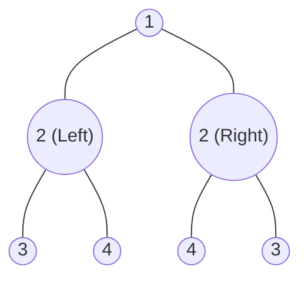

# Trees 05: Symmetrical Binary Trees (Mirror Reflection Pattern)

> **DSA Master Revision Notes** for campus placements and technical interviews (TCS NQT Hands-on Coding / Digital / Prime, Infosys DSE/SP, Cognizant, Wipro, Accenture, LeetCode). Based on Episode 05 of the Tree Series by **Padho with Pratyush**. Formatted with GitHub-compatible Markdown, KaTeX mathematics, visual mirror traces, and verified Java implementations.

---

## Table of Contents
1. [Core Intuition & The Mirror Paradigm](#1-core-intuition--the-mirror-paradigm)
   - [The Human Mirror Reflection Analogy](#the-human-mirror-reflection-analogy)
   - [The Central Vertical Axis Invariant](#the-central-vertical-axis-invariant)
2. [Method 1: Recursive Dual-Node DFS](#2-method-1-recursive-dual-node-dfs)
   - [The Outer-Inner Crossing Principle](#the-outer-inner-crossing-principle)
   - [Complete Java Implementation](#complete-java-implementation-recursive)
   - [Complexity Analysis](#complexity-analysis-recursive)
3. [Method 2: Iterative BFS Using Queue Pairs](#3-method-2-iterative-bfs-using-queue-pairs)
   - [The Pairwise Enqueue Invariant](#the-pairwise-enqueue-invariant)
   - [Complete Java Implementation](#complete-java-implementation-iterative)
   - [Complexity Analysis](#complexity-analysis-iterative)
4. [Comprehensive Step-by-Step Dry Runs](#4-comprehensive-step-by-step-dry-runs)
   - [Case 1: Symmetric Tree `[1, 2, 2, 3, 4, 4, 3]`](#case-1-symmetric-tree-1-2-2-3-4-4-3)
   - [Case 2: Asymmetric Counterexample `[1, 2, 2, null, 3, null, 3]`](#case-2-asymmetric-counterexample-1-2-2-null-3-null-3)
5. [Placement Strategy, Interview Traps & Heuristics](#5-placement-strategy-interview-traps--heuristics)
   - [The "SameTree vs. MirrorTree" Trap](#the-sametree-vs-mirrortree-trap)
   - [Single Node Trees & Edge Cases](#single-node-trees--edge-cases)
6. [Quick Formula & Concept Cheat Sheet](#6-quick-formula--concept-cheat-sheet)

---

## 1. Core Intuition & The Mirror Paradigm

### The Human Mirror Reflection Analogy
When you look straight into a physical mirror and raise your **left hand**, the reflection in the mirror raises its **right hand**.
A binary tree is **symmetric** around its center if the left subtree is the exact mirror image of the right subtree:

```text
               ( 1 )   <--- Mirror Axis |
              /     \                   |
            ( 2 )   ( 2 )               |
           /    \   /    \              |
         ( 3 ) ( 4)( 4 ) ( 3 )          |
          ▲                 ▲           |
          └─ Outer Match ───┘           |
               ▲       ▲                |
               └ Inner ┘                |
```

### The Central Vertical Axis Invariant
For every pair of mirror nodes $T_1$ and $T_2$:
1. Their values must match: $T_1.\text{val} == T_2.\text{val}$.
2. The **outer children** must be mirrors of each other:
   $$
   T_1.\text{left} \longleftrightarrow T_2.\text{right}
   $$
3. The **inner children** must be mirrors of each other:
   $$
   T_1.\text{right} \longleftrightarrow T_2.\text{left}
   $$

$$
\Large
\boxed{\text{isMirror}(T_1, T_2) \iff (T_1.\text{val} == T_2.\text{val}) \ \land \ \text{isMirror}(T_1.\text{left}, T_2.\text{right}) \ \land \ \text{isMirror}(T_1.\text{right}, T_2.\text{left})}
$$

---

## 2. Method 1: Recursive Dual-Node DFS

### The Outer-Inner Crossing Principle
To check symmetry, we cannot work with a single node pointer because the left and right branches must be compared simultaneously. We introduce a helper function:
`isMirror(TreeNode t1, TreeNode t2)`

1. **Both null:** `t1 == null && t2 == null` $\implies$ `true`.
2. **One null:** `t1 == null || t2 == null` $\implies$ `false`.
3. **Values differ:** `t1.val != t2.val` $\implies$ `false`.
4. **Recurse with crossed branches:**
   - `isMirror(t1.left, t2.right)` (Outers)
   - `isMirror(t1.right, t2.left)` (Inners)

### Complete Java Implementation: Recursive DFS

```java
class Solution {
    public boolean isSymmetric(TreeNode root) {
        // An empty tree is trivially symmetric
        if (root == null) {
            return true;
        }

        // Check if left and right subtrees mirror each other
        return isMirror(root.left, root.right);
    }

    private boolean isMirror(TreeNode t1, TreeNode t2) {
        // Base Case 1: Both nodes are null (empty leaves mirror each other)
        if (t1 == null && t2 == null) {
            return true;
        }

        // Base Case 2: One is null, the other is not (structural asymmetry)
        if (t1 == null || t2 == null) {
            return false;
        }

        // Base Case 3: Value mismatch
        if (t1.val != t2.val) {
            return false;
        }

        // Crossing Recursion:
        // 1. Compare t1's left with t2's right (Outermost pair)
        // 2. Compare t1's right with t2's left (Innermost pair)
        return isMirror(t1.left, t2.right) && isMirror(t1.right, t2.left);
    }
}
```

### Complexity Analysis
- **Time Complexity:** $\mathcal{O}(N)$ — Traverses each node in the tree once.
- **Space Complexity:** $\mathcal{O}(H)$ — Where $H$ is the height of the tree ($\mathcal{O}(\log N)$ for balanced trees, $\mathcal{O}(N)$ for skewed trees).

---

## 3. Method 2: Iterative BFS Using Queue Pairs

### The Pairwise Enqueue Invariant
Instead of recursion, we can use a `Queue<TreeNode>` to check pairs iteratively:
1. Enqueue `root.left` and `root.right`.
2. In each iteration, dequeue two nodes `t1` and `t2`.
3. Validate them using the same 3 base cases.
4. Enqueue their children in cross-mirror pairs:
   - Enqueue `t1.left` followed by `t2.right`.
   - Enqueue `t1.right` followed by `t2.left`.

### Complete Java Implementation: Iterative BFS

```java
import java.util.*;

class Solution {
    public boolean isSymmetricIterative(TreeNode root) {
        if (root == null) return true;

        Queue<TreeNode> queue = new LinkedList<>();
        // Enqueue the initial symmetric pair
        queue.offer(root.left);
        queue.offer(root.right);

        while (!queue.isEmpty()) {
            TreeNode t1 = queue.poll();
            TreeNode t2 = queue.poll();

            // Both null: continue checking remaining pairs
            if (t1 == null && t2 == null) {
                continue;
            }

            // Asymmetric structure or value mismatch
            if (t1 == null || t2 == null || t1.val != t2.val) {
                return false;
            }

            // Enqueue outer mirror pair
            queue.offer(t1.left);
            queue.offer(t2.right);

            // Enqueue inner mirror pair
            queue.offer(t1.right);
            queue.offer(t2.left);
        }

        return true;
    }
}
```

### Complexity Analysis
- **Time Complexity:** $\mathcal{O}(N)$ — Every node is enqueued and dequeued once.
- **Space Complexity:** $\mathcal{O}(N)$ — Maximum width of the queue at the leaf level.

---

## 4. Comprehensive Step-by-Step Dry Runs

### Case 1: Symmetric Tree `[1, 2, 2, 3, 4, 4, 3]`



- Initial: Compare `(2L, 2R)`. `2 == 2` $\implies$ Enqueue `(3L, 3R)` and `(4L, 4R)`.
- Step 1: Compare `(3L, 3R)`. `3 == 3` $\implies$ Enqueue child nulls `(null, null)` and `(null, null)`.
- Step 2: Compare `(4L, 4R)`. `4 == 4` $\implies$ Enqueue child nulls `(null, null)` and `(null, null)`.
- Step 3: All null pairs evaluate to `true`.
- **Result:** `true` (Tree is fully symmetrical).

---

### Case 2: Asymmetric Counterexample `[1, 2, 2, null, 3, null, 3]`

```text
        1
       / \
      2   2
       \   \
        3   3
```

- Compare `(2L, 2R)`. `2 == 2`.
- Enqueue outer pair: `(2L.left, 2R.right)` $\implies$ `(null, 3)`.
- Enqueue inner pair: `(2L.right, 2R.left)` $\implies$ `(3, null)`.
- Step 1: Dequeue `(null, 3)`.
- Condition: `t1 == null || t2 == null` evaluates to `true`!
- **Result:** Immediate `false` returned!

---

## 5. Placement Strategy, Interview Traps & Heuristics

### The "SameTree vs. MirrorTree" Trap
> [!CAUTION]
> A common interview blunder is calling `isSameTree(root.left, root.right)`.
> - `isSameTree` compares: `left with left` and `right with right`.
> - `isMirror` MUST compare: `left with RIGHT` and `right with LEFT`.
> Calling `isSameTree` on `[1, 2, 2, 3, 4, 4, 3]` will return `false` because node `3` is compared with node `4`!

---

## 6. Quick Formula & Concept Cheat Sheet

| Metric / Check | Formula / Condition | Output for LC 101 |
| :--- | :--- | :--- |
| **Mirror Crossing** | `isMirror(t1.left, t2.right) && isMirror(t1.right, t2.left)` | Core Invariant |
| **Both Null** | `t1 == null && t2 == null` | `true` |
| **One Null** | `t1 == null || t2 == null` | `false` |
| **Value Check** | `t1.val == t2.val` | Required |
| **Time Complexity** | $\mathcal{O}(N)$ | Linear scan |
| **Auxiliary Space** | $\mathcal{O}(H)$ (DFS) or $\mathcal{O}(N)$ (BFS) | Call stack vs queue |
