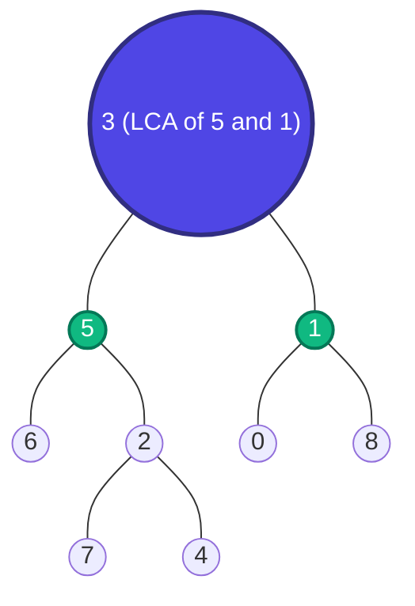

# Trees 07: Lowest Common Ancestor (LCA) in Binary Tree

> **DSA Master Revision Notes** for campus placements and technical interviews (TCS NQT Hands-on Coding / Digital / Prime, Infosys DSE/SP, Cognizant, Wipro, Accenture, LeetCode). Based on Episode 07 of the Tree Series by **Padho with Pratyush**. Formatted with GitHub-compatible Markdown, KaTeX mathematics, visual fork traces, and verified Java implementations.

---

## Table of Contents
1. [Core Intuition & The Divergence Fork Paradigm](#1-core-intuition--the-divergence-fork-paradigm)
   - [Formal Definition of LCA](#formal-definition-of-lca)
   - [The Family Reunion / Mountain Trail Analogy](#the-family-reunion--mountain-trail-analogy)
2. [The Postorder Bubble-Up Logic](#2-the-postorder-bubble-up-logic)
   - [Base Case Rules & Short-Circuiting](#base-case-rules--short-circuiting)
   - [The 4-Way Decision Matrix](#the-4-way-decision-matrix)
3. [Complete Java Implementation: LeetCode 236](#3-complete-java-implementation-leetcode-236)
   - [Clean Production Code](#clean-production-code)
   - [Complexity Analysis](#complexity-analysis)
4. [Step-by-Step Recursive Dry Run](#4-step-by-step-recursive-dry-run)
   - [Trace Scenario 1: Nodes in Different Subtrees](#trace-scenario-1-nodes-in-different-subtrees)
   - [Trace Scenario 2: One Node is the Ancestor of the Other](#trace-scenario-2-one-node-is-the-ancestor-of-the-other)
5. [Binary Tree LCA vs. Binary Search Tree (BST) LCA](#5-binary-tree-lca-vs-binary-search-tree-bst-lca)
   - [Why General Binary Tree Requires $\mathcal{O}(N)$ Search](#why-general-binary-tree-requires-mathcalon-search)
   - [How BST Exploits Sorted Invariants in $\mathcal{O}(H)$](#how-bst-exploits-sorted-invariants-in-mathcaloh)
6. [Placement Strategy, Interview Traps & Heuristics](#6-placement-strategy-interview-traps--heuristics)
   - [The Missing Node Trap](#the-missing-node-trap)
   - [Interview Pitch Strategy](#interview-pitch-strategy)
7. [Quick Formula & Concept Cheat Sheet](#7-quick-formula--concept-cheat-sheet)

---

## 1. Core Intuition & The Divergence Fork Paradigm

### Formal Definition of LCA
According to the definition on LeetCode:
> *"The lowest common ancestor is defined between two nodes $p$ and $q$ as the lowest node in $T$ that has both $p$ and $q$ as descendants (where we allow a node to be a descendant of itself)."*



In the tree above:
- `LCA(5, 1) = 3` (Root 3 splits them into left and right branches).
- `LCA(5, 4) = 5` (Node 5 is the ancestor of node 4; a node is allowed to be an ancestor of itself).

### The Family Reunion / Mountain Trail Analogy
Imagine two hikers $P$ and $Q$ climbing down from different points on a mountain toward the summit (Root). The lowest trail fork where their paths converge into a single trail to the base is their Lowest Common Ancestor.

---

## 2. The Postorder Bubble-Up Logic

### Base Case Rules & Short-Circuiting
When recursing through node `root`:
1. If `root == null`, return `null`.
2. If `root == p || root == q`, return `root`!
   - *Why don't we need to check subtrees below this node?*
   - If the other target is located inside its subtree, then this node is automatically the LCA!
   - If the other target is in a separate subtree, this node safely bubbles up as the flag indicating *"Found a target here!"*

### The 4-Way Decision Matrix
After recursing down left and right subtrees:
- `TreeNode left = lowestCommonAncestor(root.left, p, q);`
- `TreeNode right = lowestCommonAncestor(root.right, p, q);`

$$
\Large
\boxed{\text{LCA Result}(root) = 
\begin{cases}
root & \text{if } left \ne \text{null} \ \land \ right \ne \text{null} \quad (\text{Fork found!}) \\
left & \text{if } left \ne \text{null} \ \land \ right == \text{null} \\
right & \text{if } left == \text{null} \ \land \ right \ne \text{null} \\
\text{null} & \text{if } left == \text{null} \ \land \ right == \text{null}
\end{cases}}
$$

---

## 3. Complete Java Implementation: LeetCode 236

### Clean Production Code

```java
class Solution {
    public TreeNode lowestCommonAncestor(TreeNode root, TreeNode p, TreeNode q) {
        // Base Case: Empty node OR found either p or q
        if (root == null || root == p || root == q) {
            return root;
        }

        // Postorder DFS: Search in left and right subtrees
        TreeNode left = lowestCommonAncestor(root.left, p, q);
        TreeNode right = lowestCommonAncestor(root.right, p, q);

        // Case 1: Both left and right returned non-null!
        // This means p is in one subtree and q is in the other.
        // Therefore, the current root is the LCA fork!
        if (left != null && right != null) {
            return root;
        }

        // Case 2 & 3: One subtree found something, other is null.
        // Bubble up the non-null result.
        return (left != null) ? left : right;
    }
}
```

### Complexity Analysis
- **Time Complexity:** $\mathcal{O}(N)$ — In the worst case, every node in the binary tree is visited once.
- **Space Complexity:** $\mathcal{O}(H)$ — Recursion stack depth is equal to tree height ($\mathcal{O}(\log N)$ for balanced, $\mathcal{O}(N)$ for skewed).

---

## 4. Step-by-Step Recursive Dry Run

### Trace Scenario 1: Nodes in Different Subtrees
Find `LCA(6, 4)` in subtree rooted at `5`:
```text
         5
       /   \
      6     2
           / \
          7   4
```
1. `LCA(5)` calls `LCA(6)` and `LCA(2)`.
2. `LCA(6)`: Matches `root == p (6)`. Returns node `6`.
3. `LCA(2)` calls `LCA(7)` and `LCA(4)`.
   - `LCA(7)` returns `null`.
   - `LCA(4)` matches `root == q (4)`. Returns node `4`.
   - At node `2`: `left == null`, `right == 4`. Returns node `4`.
4. Back at node `5`:
   - `left = 6`
   - `right = 4`
   - Both are non-null! $\implies$ Node `5` returns itself as LCA!

---

### Trace Scenario 2: One Node is the Ancestor of the Other
Find `LCA(5, 4)`:
1. At node `3`: calls `LCA(5)` on left branch.
2. At node `5`: `root == p (5)` matches base case!
3. Node `5` immediately returns itself (`5`) to node `3` without recursing deeper into `2` and `4`.
4. Right branch from node `3` (towards `1`) returns `null` (neither `5` nor `4` are there).
5. At node `3`: `left = 5`, `right = null`. Returns `left` (`5`).
6. Final output: `5` (Correct!).

---

## 5. Binary Tree LCA vs. Binary Search Tree (BST) LCA

| Feature | Binary Tree LCA (LC 236) | BST LCA (LC 235) |
| :--- | :--- | :--- |
| **Property Used** | Pure structural DFS | Ordered values (`left < root < right`) |
| **Search Path** | Explores both branches ($\mathcal{O}(N)$) | Direct binary decision ($\mathcal{O}(H)$) |
| **Time Complexity** | $\mathcal{O}(N)$ | $\mathcal{O}(H) = \mathcal{O}(\log N)$ balanced |
| **Auxiliary Space** | $\mathcal{O}(H)$ stack | $\mathcal{O}(1)$ iterative / $\mathcal{O}(H)$ recursive |

---

## 6. Placement Strategy, Interview Traps & Heuristics

### The Missing Node Trap
> [!WARNING]
> The LeetCode 236 contract explicitly guarantees that:
> *"Both $p$ and $q$ exist in the tree."*
> If an interviewer asks: *"What if $p$ or $q$ might not be present in the tree?"*
> - The above code would incorrectly return $p$ if $p$ exists and $q$ is absent!
> - **Solution:** Use a global count `count = 0`. Increment count when $p$ or $q$ is visited. Only accept the result if `count == 2` after a complete tree traversal.

---

## 7. Quick Formula & Concept Cheat Sheet

| Condition | Action Taken | Return Value |
| :--- | :--- | :--- |
| `root == null` | Base Case | `null` |
| `root == p \|\| root == q` | Match Base Case | `root` |
| `left != null && right != null` | Fork detected | `root` (Current node is LCA) |
| `left != null && right == null` | Left subtree winner | `left` |
| `left == null && right != null` | Right subtree winner | `right` |
| `left == null && right == null` | Neither branch found targets | `null` |
