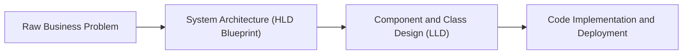
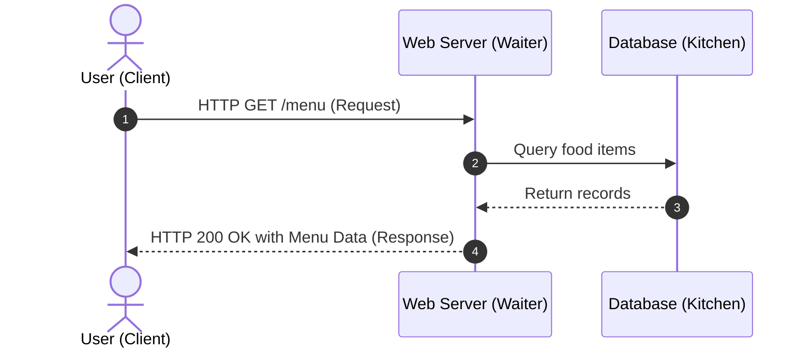
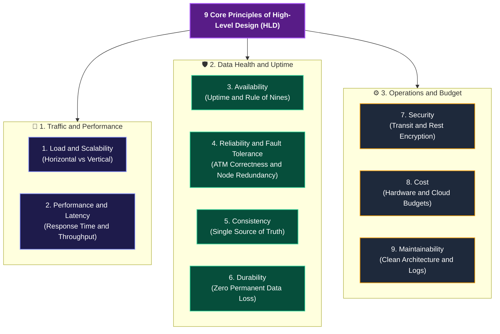
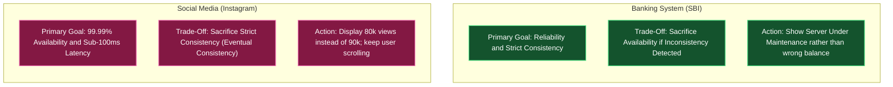
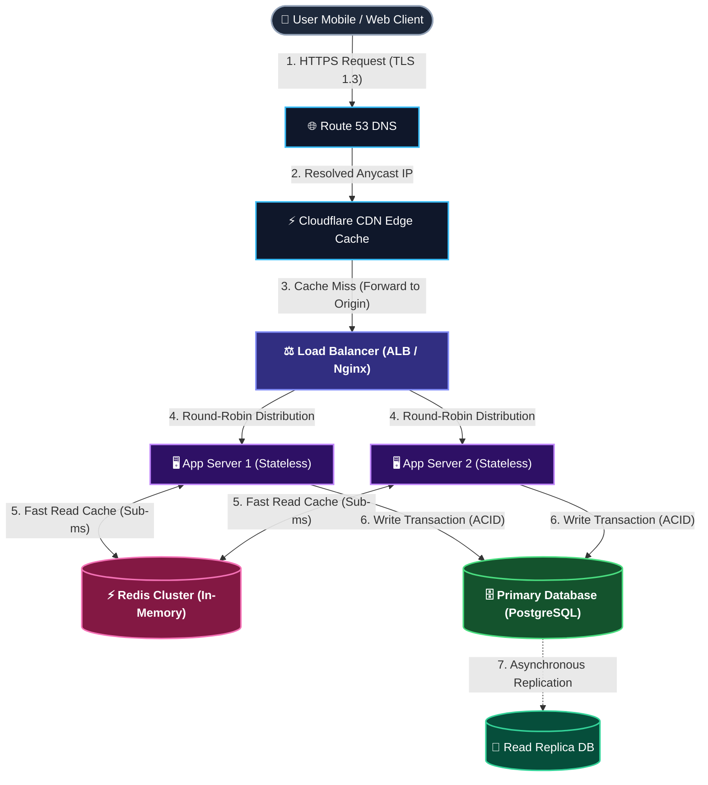

# Foundations: The 9 Core Principles & System Design Blueprint

> **System Design Master Revision Notes** for technical architecture interviews (Google, Meta, Amazon, Microsoft, Uber, TCS Digital/Prime Technical Interviews). Formatted with GitHub-compatible Markdown, KaTeX mathematical derivations, Mermaid request lifecycles, and production trade-off decision matrices.

---

## Table of Contents
1. [Why System Design Matters (The AI Era Paradigm Shift)](#1-why-system-design-matters-the-ai-era-paradigm-shift)
2. [High-Level Design (HLD) vs. Low-Level Design (LLD)](#2-high-level-design-hld-vs-low-level-design-lld)
3. [Networking Primitives: The Client-Server Model & Restaurant Analogy](#3-networking-primitives-the-client-server-model--restaurant-analogy)
4. [The Golden Rule of Trade-Offs (The Delhi-to-Patna Matrix)](#4-the-golden-rule-of-trade-offs-the-delhi-to-patna-matrix)
5. [The 9 Core Principles of High-Level Design](#5-the-9-core-principles-of-high-level-design)
   - [Principle 1: Load & Scalability](#principle-1-load--scalability)
   - [Principle 2: Performance & Latency](#principle-2-performance--latency)
   - [Principle 3: Availability & "The Rule of Nines"](#principle-3-availability--the-rule-of-nines)
   - [Principle 4: Reliability & Fault Tolerance](#principle-4-reliability--fault-tolerance)
   - [Principle 5: Consistency](#principle-5-consistency)
   - [Principle 6: Durability](#principle-6-durability)
   - [Principle 7: Security](#principle-7-security)
   - [Principle 8: Cost](#principle-8-cost)
   - [Principle 9: Maintainability](#principle-9-maintainability)
6. [Case Study: Banking Architecture (SBI) vs. Social Media (Instagram)](#6-case-study-banking-architecture-sbi-vs-social-media-instagram)
7. [System Request-Response Lifecycle & Failure States](#7-system-request-response-lifecycle--failure-states)
8. [Placement Strategy, Interview Heuristics & Common Traps](#8-placement-strategy-interview-heuristics--common-traps)
9. [Action Plan: Articulating Your Resume Project](#9-action-plan-articulating-your-resume-project)
10. [Quick Concept & Decision Cheat Sheet](#10-quick-concept--decision-cheat-sheet)

---

## 1. Why System Design Matters (The AI Era Paradigm Shift)

### Simple Level (The Core Idea)
Writing syntax-error-free code is no longer a rare competitive advantage. AI engines and copilot tools write boilerplate code, generate LeetCode solutions, and fix compilation bugs in seconds.

$$
\Large
\boxed{\text{"Syntax is cheap. Architectural decision-making is irreplaceable."}}
$$

Writing code without understanding System Design is like laying bricks on empty ground without an architect's blueprint. If you try to build a 40-story residential apartment complex without calculating load-bearing foundations, water pressure distribution, sewage pipelines, and lift elevator banks, the entire tower will collapse once people move in.

System Design is the discipline of creating that **architectural blueprint** before writing a single line of application code.



---

## 2. High-Level Design (HLD) vs. Low-Level Design (LLD)

In modern software engineering and tech interviews, system engineering is split into two complementary layers:

```
┌────────────────────────────────────────────────────────────────────────┐
│                      40-Story Apartment Building                       │
├──────────────────────────────────┬─────────────────────────────────────┤
│   High-Level Design (HLD)        │    Low-Level Design (LLD)           │
│   "The Macro Architecture"       │    "The Micro Implementation"       │
├──────────────────────────────────┼─────────────────────────────────────┤
│ • Where the elevators are placed │ • Floor tile patterns in each room  │
│ • How water reaches the 40th fl. │ • Paint shade on the bedroom walls  │
│ • Electrical transformer sizing  │ • Switchboard socket placement      │
│ • External road connection       │ • Door hinges and cabinet handles   │
├──────────────────────────────────┼─────────────────────────────────────┤
│ • Which Databases to use         │ • Class diagrams & OOP interfaces   │
│ • API Gateways & Load Balancers  │ • Database schemas & column types   │
│ • Caching tiers & Message Queues │ • Design Patterns (Factory, Strategy)│
│ • Data flow between microservices│ • Writing actual, runnable code     │
│ • NO coding required in HLD      │ • Heavy hands-on machine coding     │
└──────────────────────────────────┴─────────────────────────────────────┘
```

> [!IMPORTANT]
> **No Coding in HLD Interviews**: In an HLD interview round, you do **not** write code. You discuss distributed systems, draw architecture diagrams, calculate capacities, and defend technical trade-offs. In an LLD / Machine Coding round, you write clean, modular, object-oriented code with test cases.

---

## 3. Networking Primitives: The Client-Server Model & Restaurant Analogy

At the hardware foundation, every device connected to the internet—your smartphone, laptop, smartwatch, or a warehouse-sized Google server cluster—is simply a **Machine** or **Host** possessing a unique IP address.

Systems communicate using the **Client-Server Architecture**:
- **Client**: The host that initiates communication and asks for resources or data (sends a **Request**).
- **Server**: The host that processes the incoming request, fetches or computes the required data, and returns it (sends a **Response**).



### The Restaurant Analogy of System Responses
Think of yourself dining at a restaurant:
- **You** are the **Client**.
- The **Waiter** is the **Server / API Gateway**.
- The **Kitchen & Pantry** is the **Database / Storage Tier**.

When you place an order (Request), a response is **not** guaranteed to be what you wanted. In computer systems, all of the following represent valid response states:

1. **Successful Response (`200 OK`)**: You order a club sandwich, and the waiter delivers the fresh club sandwich within 10 minutes.
2. **Incorrect Output (Data Inconsistency / Bug)**: You order a vegetarian sandwich, but the waiter brings a fried egg burger. (System is available, but unreliable).
3. **Delayed Response (High Latency / Bottleneck)**: You order soup, but it arrives after 90 minutes when you are about to leave. (System responded, but violated latency SLAs).
4. **Dropped / Lost Request (Network Timeout / Packet Drop)**: You tell the waiter your order, but the waiter gets distracted and forgets to take it to the kitchen.
5. **Outright Refusal (`503 Service Unavailable` / `429 Too Many Requests`)**: The kitchen is completely on fire, or the restaurant is at maximum capacity, and the manager turns you away at the door.

---

## 4. The Golden Rule of Trade-Offs (The Delhi-to-Patna Matrix)

Unlike LeetCode or competitive programming, **System Design has no single "correct" answer** that can be memorized from a sheet.

Every architectural decision comes with a compromise. If you optimize for parameter $X$, you will inevitably sacrifice parameter $Y$. This compromise is called a **Trade-Off**.

$$
\Large
\boxed{\text{System Design} = \text{The Art of Choosing the Right Compromise for Given Constraints}}
$$

### The Delhi to Patna Travel Dilemma
Imagine an interviewer asks: *"What is the absolute best way to travel from Delhi to Patna?"*

If you immediately blurt out *"Take a flight!"*, you fail the interview. Why? Because you answered without discovering the user's constraints.

| Travel Option | Travel Time | Ticket Price (Cost) | Physical Comfort | Ideal User Profile |
| :--- | :--- | :--- | :--- | :--- |
| **Flight** | **Best** (~1.5 hours) | **Worst** (Expensive: ₹6,000+) | **Medium** (Cramped upright seat) | A corporate executive with urgent meetings who values time over money. |
| **AC 3-Tier Train** | **Medium** (~14 hours) | **Medium** (Affordable: ₹1,400) | **Best** (Sleeping berth, AC, bedsheet) | A traveler with severe back pain who prioritizes restful sleep over speed. |
| **General Train Coach**| **Medium** (~16 hours) | **Best** (Cheapest: ₹250) | **Worst** (Overcrowded, standing room) | A student or daily-wage worker with strictly minimal financial budget. |

### The Engineering Takeaway
If you demand both the **fastest travel time** (1.5 hours) and **luxury sleeping comfort** (flat-bed berth), your only option is an International First/Business Class flight—which costs **$5\times$ to $10\times$ more**.

In software systems:
- You cannot achieve sub-millisecond latency, zero downtime, global data consistency, and infinite durability on a $\$500/\text{month}$ server budget.
- You must ask the interviewer: *"What are our constraints? Do we prioritize latency, consistency, or cost?"*

---

## 5. The 9 Core Principles of High-Level Design

Whenever you analyze, design, or critique an architecture, you must evaluate these 9 non-functional parameters:



---

### Principle 1: Load & Scalability
- **Definition**: The volume of traffic (requests per second, concurrent connections, data storage volume) a system can handle before crashing, and how easily it can expand as traffic multiplies.
- **The Housing Analogy**: You have a house accommodating 20 family members. Next year, 20 more relatives arrive. You have two scaling options:
  1. **Vertical Scaling (Scale-Up)**: Building additional floors on top of your existing building. In servers: replacing an 8-core, 16 GB RAM server with a 64-core, 256 GB RAM super-server.
     - *Limitation*: Hardware has hard physical limits; eventually, no larger machine exists, and a single machine remains a Single Point of Failure (SPOF).
  2. **Horizontal Scaling (Scale-Out)**: Buying another parcel of land next door and building an identical house. In servers: adding 10 standard commodity servers behind a Load Balancer.
     - *Limitation*: Introduces distributed network latency and data synchronization complexity.

---

### Principle 2: Performance & Latency
- **Definition**: **Latency** is the time duration elapsed between a client dispatching a request and receiving the first byte of the response. **Throughput** is the number of requests completed per second.
- **The ChatGPT Analogy**: When you submit a prompt to an AI model, does the response stream back in 1 second, 5 seconds, or 1 hour? For interactive chat, 1 second is acceptable; 1 hour renders the product unusable.
- **Latency Tiers**:
  - RAM access: $\approx 100\text{ ns}$
  - SSD NVMe read: $\approx 100\text{ }\mu\text{s}$
  - Cross-datacenter network round-trip: $\approx 100\text{ ms}$

---

### Principle 3: Availability & "The Rule of Nines"
- **Definition**: The percentage of total time that a system remains operational, responsive, and accessible to clients.
- **The IRCTC Tatkal Failure**: When millions of users simultaneously open IRCTC at 10:00 AM for Tatkal train tickets and receive `HTTP 503 Service Unavailable`, the system has zero availability.

#### The Physical Impossibility of 100% Availability
No computer system on Earth can guarantee $100\%$ uptime over multi-year horizons. Hardware chips burn out, underwater fiber-optic cables get severed by ship anchors, power grids fail, and OS kernels encounter unforeseen panics.

Therefore, availability is engineered using redundant nodes and measured in **"Nines"**:

$$
\Large
\boxed{\text{Availability } (\%) = \frac{\text{Total Operational Uptime}}{\text{Total Operational Uptime} + \text{Downtime}} \times 100}
$$

| Availability Level | Common Industry Name | Allowed Downtime per Year | Production Meaning |
| :--- | :--- | :--- | :--- |
| **$99\%$** | "Two Nines" | **$3.65\text{ days}$** ($87.6\text{ hrs}$) | Unacceptable for e-commerce or SaaS. Costly business disaster. |
| **$99.9\%$** | "Three Nines" | **$8.76\text{ hours}$** | Typical standard for internal corporate tools and non-critical SaaS. |
| **$99.99\%$** | "Four Nines" | **$52.6\text{ minutes}$** | Gold standard for consumer tech giants (Amazon, Google, Netflix). |
| **$99.999\%$** | "Five Nines" | **$5.26\text{ minutes}$** | Telecommunications, financial payment rails, core banking infrastructure. |

> [!WARNING]
> **Why 99% is Terrible for Amazon**: A $99\%$ availability sounds good to non-engineers, but it means Amazon would be down for **more than 3 full days** every year. During major shopping festivals (Black Friday / Diwali), even 1 hour of downtime causes **hundreds of millions of dollars** in lost sales and reputational ruin.

---

### Principle 4: Reliability & Fault Tolerance

These two terms are frequently confused in placement interviews, but represent distinct properties:

#### 1. Reliability (Correctness Under Operation)
- A system can be **Available** while simultaneously being **Unreliable**.
- **The Defective ATM Analogy**: You walk up to an ATM. The screen is illuminated, buttons are functional, and the card reader works (System is $100\%$ Available). You request a withdrawal of ₹500. The machine makes whirring sounds and dispenses **₹400**, yet your account statement displays ₹500 deducted.
  - The machine is Available, but **completely Unreliable**.
  - Any bank customer would vastly prefer the ATM screen to display *"Out of Service"* (Unavailable) rather than dispense inaccurate money.

#### 2. Fault Tolerance (Graceful Resilience to Component Failure)
- The ability of a system to continue normal operations without interruption when one or more underlying hardware or software components fail.
- **The Cricket Team Analogy**: In an 11-player cricket team, if one fielder pulls a hamstring and leaves the ground, the team does not forfeit the match. A substitute fielder comes on, or the remaining 10 fielders adjust their field positions and keep playing.
- If a distributed cluster has 10 database servers and 1 server suffers a power supply failure, the remaining 9 servers absorb traffic without the end-user ever noticing an error.

---

### Principle 5: Consistency
- **Definition**: Every client reading from the system sees the most up-to-date, accurate, and identical state of data regardless of which server replica answers the request.
- **The Pratyush-Divya Bank Transfer Example**:
  - Pratyush has ₹1,000 in his bank account. He initiates a transfer of ₹100 to Divya.
  - **Atomic & Consistent State**: Pratyush's balance becomes ₹900, and Divya's balance increases by exactly ₹100.
  - **Inconsistent Failure State**: If ₹100 is deducted from Pratyush, but the database connection fails before crediting Divya, leaving Divya with ₹0 and ₹100 missing from the universe, the system is **Inconsistent**.

---

### Principle 6: Durability
- **Definition**: Once a transaction is completed and acknowledged to the user as successful, that data is permanently etched into persistent storage and will **never be lost or corrupted**, even during catastrophic power outages or server reboots.
- **The Instagram Follower Count Example**:
  - A content creator works for 3 years to build a following of 263,000 users.
  - If Meta's data center loses power or suffers a cluster crash for 45 minutes, Instagram cannot reboot and say: *"Sorry, our servers restarted and our RAM cleared. Your follower count is now 0. Please ask everyone to follow you again."*
  - The follower relationships are written to persistent write-ahead logs (WAL) and replicated across disks in multiple geographic zones.

---

### Principle 7: Security
- **Definition**: Defending systems, networks, and data stores against unauthorized intrusion, data breaches, distributed denial of service (DDoS) floods, and privilege escalation.
- Core pillars include:
  - **Encryption in Transit**: TLS/HTTPS preventing packet sniffing between client and load balancer.
  - **Encryption at Rest**: AES-256 disk encryption protecting hard drives against physical theft.
  - **Authentication & Authorization**: Verifying user identity (OAuth2, JWT) and permission boundaries (RBAC).

---

### Principle 8: Cost
- **Definition**: The financial expenditure required to build, host, operate, and maintain software infrastructure.
- **The Gold Tiles Analogy**:
  - When asked how to build an application in an interview, amateur candidates often say: *"I will put a 100-node Redis cluster in front of 500 auto-scaled EC2 instances with multi-region active-active database replication!"*
  - This is the engineering equivalent of demanding **24-karat solid gold floor tiles** in a standard budget residential building.
  - Engineering is not about infinite spending; it is about delivering business SLAs within reasonable financial budgets.

---

### Principle 9: Maintainability
- **Definition**: The ease with which engineering teams can understand, debug, patch, refactor, monitor, and evolve the architecture over years as engineers join and leave the organization.
- **The Tangled Wire Analogy**:
  - If an engineer builds a system using obscure frameworks, undocumented microservices, and unorganized dependency graphs, it becomes a hazardous "tangled rat's nest of wires."
  - When that engineer resigns, the next developer cannot make changes without breaking production.

---

## 6. Case Study: Banking Architecture (SBI) vs. Social Media (Instagram)

To see the 9 principles in action during an interview, consider how a Tier-1 Bank (e.g., State Bank of India / Chase) and a Global Social Media Platform (Instagram / TikTok) prioritize their non-functional trade-offs:



### The Architectural Comparison Matrix

| System Dimension | Banking Platform (e.g., SBI / HDFC) | Social Media (e.g., Instagram / TikTok) |
| :--- | :--- | :--- |
| **Top 1 Priority** | **Reliability & Strict Consistency** (ACID) | **High Availability & Low Latency** |
| **Acceptable Compromise** | **Availability** (Willing to show downtime) | **Consistency** (Eventual Consistency accepted) |
| **Real-World Consequence** | If your ₹2,00,000 balance mistakenly shows ₹500, customers will panic, call the news media, and file police complaints. | If a Reel has 90,000 views but your phone shows 80,000 views for 5 minutes, nobody calls the police. |
| **Handling Partition Failures** | If network partitions make data synchronization uncertain, the bank server **shuts down** transactions (`"Server is temporarily unavailable"`). | The feed server displays slightly stale cached posts so the user can continue scrolling without interruption. |
| **Database Paradigm** | Relational Databases (PostgreSQL, Oracle) with strict 2-Phase Commit (2PC) / Saga. | NoSQL distributed key-value stores (Cassandra, DynamoDB) optimized for fast reads. |

---

## 7. System Request-Response Lifecycle & Failure States

The diagram below illustrates how client requests traverse modern distributed infrastructure, and where the 9 principles manifest:



### Response States & HTTP Status Codes

1. `200 OK`: Request succeeded; accurate data returned with low latency.
2. `304 Not Modified`: Cached data on client CDN is still fresh (saves bandwidth & cost).
3. `429 Too Many Requests`: Client exceeded rate limiter threshold (protects availability).
4. `500 Internal Server Error`: Unhandled server exception (violates reliability).
5. `503 Service Unavailable`: Server cluster overloaded or under maintenance (loss of availability).
6. `504 Gateway Timeout`: Downstream database took too long to answer (latency violation).

---

## 8. Placement Strategy, Interview Heuristics & Common Traps

### What You Should Do in an Interview:
1. **The 45-Second Clarification Pause**: When an interviewer says *"Design Instagram"* or *"Design a Payment Service"*, **never start drawing boxes immediately**. Pause, grab your pen or digital whiteboard, and ask 3–4 clarifying constraint questions:
   - *"What is our target scale in terms of Daily Active Users (DAU) and read-to-write ratio?"*
   - *"Do we prioritize strict consistency (like an account balance) or high availability with eventual consistency (like social feeds)?"*
   - *"What is our expected latency SLA for critical write and read endpoints?"*
2. **Defend Decisions Using Principles**: When choosing a component, explicitly cite the trade-off: *"I am selecting PostgreSQL over MongoDB here because our business requirement demands strict ACID consistency and transaction rollbacks for financial ledger entries."*

### What You Must Avoid:
- **The "Utopia" Trap**: Never claim your system provides $100\%$ availability, zero latency, and $100\%$ consistency simultaneously. The laws of distributed physics (CAP Theorem) make this impossible.
- **The "Infinite Hardware" Trap**: Never answer every scaling bottleneck by saying *"I'll just add 50 more servers and 20 more Redis instances."* Always acknowledge the infrastructure cost.
- **The "Premature Database" Trap**: Never say *"We will use MongoDB"* before defining what data needs to be stored, how often it is queried, and what read/write throughput is needed.

---

## 9. Action Plan: Articulating Your Resume Project

To prepare for technical interview discussions around projects listed on your resume:

### The 2-Sentence Framework for Resume Defense:
1. **Sentence 1 (Priority Principle)**:
   > *"In my [Project Name] project, the primary architectural principle I prioritized was **[Consistency / Latency / Availability]**, because [concrete business reason, e.g., user authentication tokens must be valid immediately upon login]."*
2. **Sentence 2 (Trade-off Acknowledged)**:
   > *"To achieve this, the trade-off I made was **[Cost / Latency / Complexity]** by [specific design choice, e.g., implementing synchronous database writes instead of an asynchronous queue, accepting higher write latency in exchange for zero stale reads]."*

---

## 10. Quick Concept & Decision Cheat Sheet

| Principle | Core Invariant / Formula | Key Analogy | When to Prioritize | Accepted Trade-Off |
| :--- | :--- | :--- | :--- | :--- |
| **Scalability** | $\text{Horizontal} \gg \text{Vertical}$ | Building more floors vs. houses next door | High user growth (1K $\to$ 1M DAU) | Distributed network coordination complexity |
| **Latency** | $T_{\text{response}} = T_{\text{network}} + T_{\text{compute}} + T_{\text{DB}}$ | ChatGPT response streaming delay | Interactive apps, search, gaming | Higher cost (in-memory Redis / CDN tiers) |
| **Availability** | $\frac{\text{Uptime}}{\text{Uptime} + \text{Downtime}} \times 100$ | IRCTC Tatkal crashing at 10 AM | Consumer products, e-commerce | Eventual consistency, multi-region replication cost |
| **Reliability** | Correctness under all operational states | ATM giving ₹400 for a ₹500 request | Financial ledgers, healthcare systems | Lower availability (shut down rather than err) |
| **Consistency** | All replicas return latest write data | Pratyush $\to$ Divya ₹100 transfer | Banking, stock exchanges, inventory | Higher write latency, potential downtime |
| **Durability** | Data survives total hardware power-off | Instagram follower count never resetting | User profiles, financial records, audits | Slower writes (forced disk sync / WAL replication) |
| **Cost** | $\text{Architecture} \le \text{Budget}$ | Solid gold floor tiles in budget flats | Startups, constrained production budgets | Lower redundancy, aggressive caching |
| **Maintainability**| Clean interfaces $\&$ documented flows | Tangled rats-nest wires in a server rack | Long-term enterprise software | Additional upfront development time |

